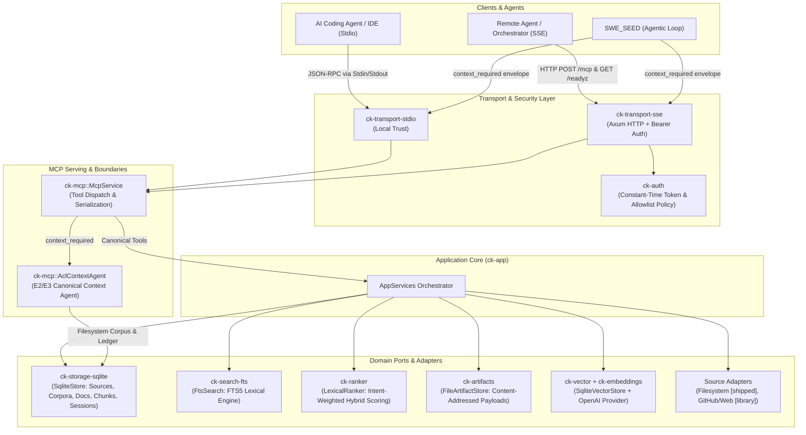

# Context Kernel Documentation

Welcome to the technical knowledge system for **Context Kernel**.

Context Kernel is a local-first, single-binary Rust service implementing the [Model Context Protocol (MCP)](https://modelcontextprotocol.io/) to provide AI coding agents with durable session memory, version-aware documentation retrieval, and token-efficient reference lookup backed by SQLite, FTS5, filesystem artifacts, and explicit authorization boundaries.

---

## The System in One Picture



---

## The 8 Concepts You Need First

1. **Source**: An origin of external documentation (a local directory tree, a GitHub repository, or a web domain) associated with a freshness TTL and update revision tracking.
2. **Corpus**: An administrative retrieval boundary grouping one or more sources. Corpora define authorization scopes (`allow_corpora`) and partition documents.
3. **Document & Chunk**: An ingested resource (e.g., Markdown or text file) is stored as a `Document`. Documents are split by structural headings or token ceilings (~800 words) into `Chunks`, which are indexed in SQLite FTS5 for BM25 search.
4. **Library Identity & Alias**: A canonical package identifier (e.g., `provider="crates.io"`, `name="tokio"`, `version="1.38.0"`) with searchable aliases. Enables resolving colloquial agent queries (e.g., "tokio-rs") to exact library documentation.
5. **Session & Session Event**: A durable agent interaction timeline. Events record agent decisions, requirements, constraints, and notes. Events are classified as `Pinnable`, `Permanent`, or `Ephemeral`.
6. **Artifact Store**: A content-addressed filesystem storage area (`<data_dir>/artifacts/`) that stores large text or binary payloads offloaded from prompts. Session events reference artifacts by `artifact_id` and SHA-256 checksum.
7. **Retention GC**: A startup maintenance sweep that purges unpinned session events, inactive sessions, completed refresh jobs, and stale artifact files while strictly preserving `pinned` events.
8. **E2/E3 Boundary (`context_required`)**: The frozen convergence contract with the wider GodSpeed ecosystem (SWE_SEED and SEA-Forge). Context Kernel acts purely as contextual authority (resolving citations into a `ContextPacketCreated` payload) and never manufactures action authorization.

---

## A Representative Journey: Searching Documentation

Here is what happens when an AI agent requests documentation through Context Kernel:

```text
Agent Prompt: "How do I configure graceful shutdown in Axum?"
  │
  ├── 1. MCP Tool Call: Agent invokes query_reference
  │      {"query": "axum graceful shutdown", "intent": "query_docs", "top_k": 5}
  │
  ├── 2. Transport Ingress:
  │      Stdio line deserialized by ck-transport-stdio or validated over SSE by ck-auth.
  │
  ├── 3. Orchestration (ck-app::AppServices::query_reference):
  │      - Analyzes query intent (QueryIntent::QueryDocs)
  │      - Queries SQLite FTS5 chunks_fts table for BM25 lexical match
  │      - If semantic embeddings are configured, retrieves vector cosine matches
  │
  ├── 4. Intent-Weighted Ranking (ck-ranker::LexicalRanker):
  │      - Applies WeightProfile for QueryDocs: FTS (60%), Trust (15%), Freshness (15%), Semantic (10%)
  │      - Normalizes BM25 score (inverting SQLite's negative metric)
  │      - De-duplicates chunks belonging to the same document
  │
  ├── 5. Citation Assembly:
  │      - Fetches chunk text, section heading, document URI, and library version
  │      - Assembles token-efficient excerpts (not whole pages)
  │
  └── 6. MCP Response:
         Returns structured matches with exact citations and score breakdowns.
```

---

## Navigating by Intent

Choose your path based on what you need to achieve right now:

### 🚀 Get Something Running Quickly
* [Getting Started / First Steps](tutorials/01-first-steps.md) — Build the binary, run migrations, verify database health, and execute your first stdio MCP store/recall call.
* [Local Documentation Indexing Tutorial](tutorials/02-local-documentation-indexing.md) — Index a local documentation directory and query it with citations.
* [Installation Guide](install.md) — Toolchain requirements, dependencies, and release binaries.

### 🧠 Understand How the System Works
* [System Mental Model](mental-model.md) — Conceptual structure, boundaries, state ownership, and invariants.
* [Architecture Overview](architecture.md) — Deep architectural specification covering logical, runtime, dependency, and data models.
* [Domain Concepts & Vocabulary](concepts.md) — Comprehensive guide to Context Kernel domain terminology.
* [Documentation Map](documentation-map.md) — Detailed catalog of all documentation pages, their purpose, Diátaxis type, and prerequisites.

### 📦 Explore Subsystems & Internals
* [Core & Domain](subsystems/core-and-domain.md) — Domain entities and port traits in `ck-core` and memory policies in `ck-memory`.
* [Storage & Persistence](subsystems/storage-and-persistence.md) — SQLite schema, WAL mode, FTS5 virtual tables, and filesystem artifact storage.
* [Retrieval & Ranking](subsystems/retrieval-and-ranking.md) — FTS5 lexical engine, intent-weighted hybrid ranking, and optional OpenAI embeddings.
* [Source Adapters](subsystems/source-adapters.md) — Filesystem ingestion, GitHub tree API, and SSRF-protected Web adapter.
* [Application Orchestration](subsystems/application-orchestration.md) — Use case coordination in `ck-app::AppServices`.
* [MCP & Protocol Serving](subsystems/mcp-and-protocols.md) — `McpService`, JSON-RPC stdio handler, axum SSE HTTP endpoints, and bearer token authorization.
* [Runtime & CLI](subsystems/runtime-and-cli.md) — Binary entry point (`context-kernal`), configuration loading, tracing, and scheduler.

### 🔍 Trace Execution Workflows
* [Service Lifecycle & Startup](workflows/service-lifecycle-and-startup.md) — CLI flags, config loading, migration, listener binding, background threads, and hot reload.
* [Documentation Ingestion & Refresh](workflows/documentation-ingestion-and-refresh.md) — Discovering files, normalising Markdown, generating chunks, and coalescing refresh jobs.
* [Reference Query & Resolution](workflows/reference-query-and-resolution.md) — Lexical search, vector search, hybrid scoring, and citation building.
* [Session Context Continuity](workflows/session-context-continuity.md) — Storing events, offloading payloads to artifacts, recalling history, and retention GC.
* [Agentic Capability Loop](workflows/agentic-capability-loop.md) — The `context_required` tool and the frozen E2/E3 boundary with SWE_SEED and SEA-Forge.

### 💡 Understand Design Rationale & Trade-offs
* [Architectural Decisions](explanation/architectural-decisions.md) — Why ports-and-adapters, why SQLite+FTS5, why single-binary delivery.
* [Retrieval & Ranking Design](explanation/retrieval-and-ranking-design.md) — Why token-efficient excerpts instead of whole documents, BM25 inversion, and intent profiles.
* [Retention & Memory Model](explanation/retention-and-memory-model.md) — Tiered event classification, pinned persistence, and GC trade-offs.
* [Known Limits & Technical Debt](explanation/known-limits-and-debt.md) — Honest inventory of wired vs unwired adapters, FTS write atomicity, and scheduler bypass.

### 🛠️ Perform Operational Tasks
* [Configure SSE with Bearer Authentication](how-to/configure-sse-with-auth.md) — Expose MCP over HTTP with token security and allowlists.
* [Manage Database & Migrations](how-to/manage-database-and-migrations.md) — Run schema migrations, verify health (`doctor`), and rebuild FTS indexes.
* [Configure Semantic Retrieval](how-to/configure-semantic-retrieval.md) — Enable OpenAI-compatible embeddings and vector search.
* [Implement a New Source Adapter](how-to/implement-a-source-adapter.md) — Step-by-step guide to writing a custom `SourceAdapter`.

### 📖 Look Up Concrete Details
* [Source Map](source-map.md) — Direct mapping from concepts, ports, and tools to exact source files and symbols.
* [CLI Reference](reference/cli.md) — Comprehensive reference for all `context-kernal` subcommands and flags.
* [Configuration Reference](reference/configuration.md) — Full TOML configuration reference, defaults, and env interpolation.
* [MCP Tools Reference](reference/mcp-tools.md) — Canonical MCP tools, compatibility aliases, JSON-RPC schemas, and error codes.
* [Database Schema Reference](reference/database-schema.md) — Complete SQLite DDL, tables, virtual tables, triggers, indexes, and enum representations.
* [Troubleshooting Guide](troubleshooting.md) — Diagnostic checklists, error codes, common failure modes, and recovery steps.
