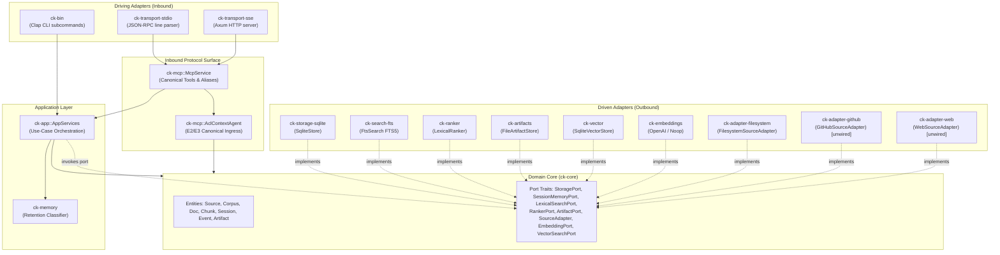
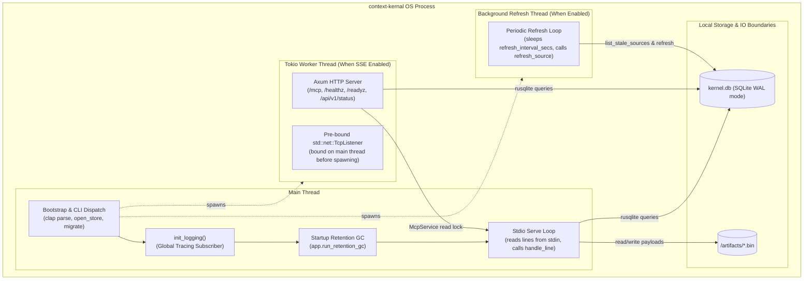
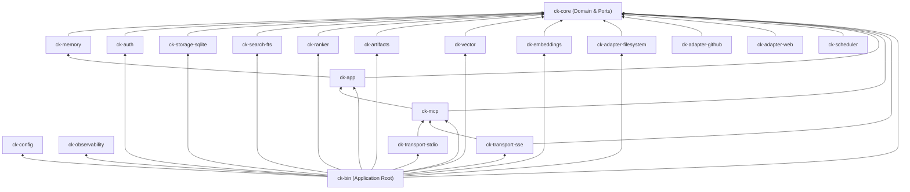
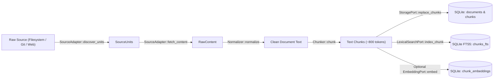
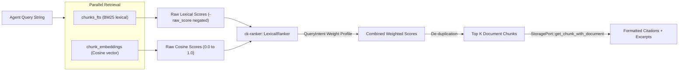
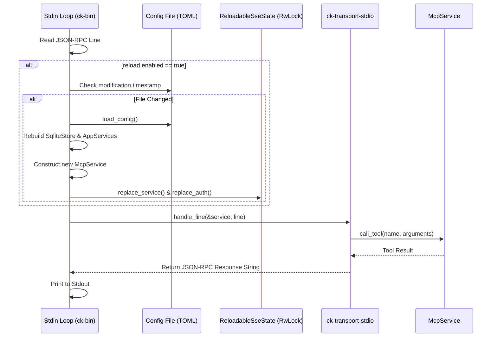

# Architecture Overview

This document specifies the canonical architecture of Context Kernel. It presents the logical, runtime, dependency, data, control flow, and security architectures that govern the implementation.

---

## 1. Logical Architecture (Ports-and-Adapters)

Context Kernel strictly adheres to the **ports-and-adapters (hexagonal) architecture** pattern. The domain core defines entity structures and abstract port traits. Infrastructure concerns (SQLite, FTS5, HTTP, filesystem IO, external APIs) exist strictly as pluggable adapters.

### Architectural Rules
1. **No Infrastructure Leaks in `ck-core`**: `ck-core` contains zero SQL statements, zero HTTP dependencies, and zero filesystem calls. It depends only on standard libraries, `anyhow`, `chrono`, `serde`, and `ulid`.
2. **Ports Own the Contracts**: Driving callers (e.g. `AppServices`) hold `Box<dyn Port>` traits. Concrete storage or network crates never call each other directly; they communicate across domain entity boundaries.
3. **Composition at the Edge**: Concrete adapter instantiation and trait object wiring happens exclusively in the composition root (`crates/ck-bin/src/main.rs::wire_app`).

---

## 2. Runtime & Process Topology

Context Kernel executes as a **single, standalone Linux/Unix or Windows binary** named `context-kernal`. It requires no external background daemon, database server, or container runtime.

### Key Operational Properties
* **Deterministic Fail-Early Bind**: The TCP listener for SSE (`std::net::TcpListener::bind(sse_bind)`) is executed on the **main thread** before spawning the Tokio runtime thread. If the port is occupied or permission is denied, the process immediately aborts with an exit code, avoiding "silent headless zombie" execution.
* **Synchronous SQLite Engine**: Storage operations use synchronous `rusqlite` connections protected by SQLite's internal locking and WAL (`Write-Ahead Logging`) concurrency mode.
* **Independent Background Workers**: The periodic refresh worker runs as an OS thread, polling `list_stale_sources` at the configured interval (`scheduler.refresh_interval_secs`).

---

## 3. Dependency Architecture

The workspace consists of 20 crates organized in a strictly unidirectional dependency tree. No cyclic dependencies exist.

### Dependency Observations
* `ck-bin` is the composition root. It depends on all functional adapters to wire them into `ck-app::AppServices`.
* Notice that `ck-adapter-github`, `ck-adapter-web`, and `ck-scheduler` compile and pass tests within the workspace, but are **deliberately not imported** by `ck-bin/Cargo.toml`. They exist as fully implemented library crates pending runtime composition.

---

## 4. Data Architecture & Storage Pipelines

Context Kernel moves data through two primary pipelines: Ingestion and Retrieval.

### Ingestion Pipeline (External Sources → Chunks)

### Retrieval Pipeline (Query → Scored Excerpts)

---

## 5. Control Flow & Hot Config Reload

In Stdio mode, Context Kernel can detect on-disk configuration changes on every incoming JSON-RPC line without dropping connection state.

---

## 6. Trust & Security Boundaries

Context Kernel operates under two distinct trust profiles:

1. **Local Stdio Trust Mode**:
   - Boundary: OS process boundary.
   - Intended for local CLI, IDE extensions (VS Code, Cursor), and local developer agents.
   - Authentication is disabled by default (`BearerAuth::no_auth()`).
   - The caller is assumed to have direct system execution privileges.

2. **Remote SSE Boundary**:
   - Boundary: Network TCP / HTTP boundary.
   - When `require_auth = true`, every HTTP request to `/mcp` must present a `Bearer <token>` header.
   - Token validation uses `subtle::ConstantTimeEq` to prevent timing side-channel attacks.
   - Granular tool allowlists (`allow_tools`) and corpus allowlists (`allow_corpora`) restrict which tools and corpora the token holder may access.
   - SSRF Protection: The Web adapter blocks private IP networks, loopback addresses, non-HTTP schemes, and unresolvable hostnames.

---

## 7. Further Subsystem Exploration

To inspect specific implementation details, proceed to the subsystem guides:
* [Core & Domain Subsystem](subsystems/core-and-domain.md)
* [Storage & Persistence Subsystem](subsystems/storage-and-persistence.md)
* [Retrieval & Ranking Subsystem](subsystems/retrieval-and-ranking.md)
* [Source Adapters Subsystem](subsystems/source-adapters.md)
* [Application Orchestration Subsystem](subsystems/application-orchestration.md)
* [MCP & Protocol Serving Subsystem](subsystems/mcp-and-protocols.md)
* [Runtime & CLI Subsystem](subsystems/runtime-and-cli.md)
