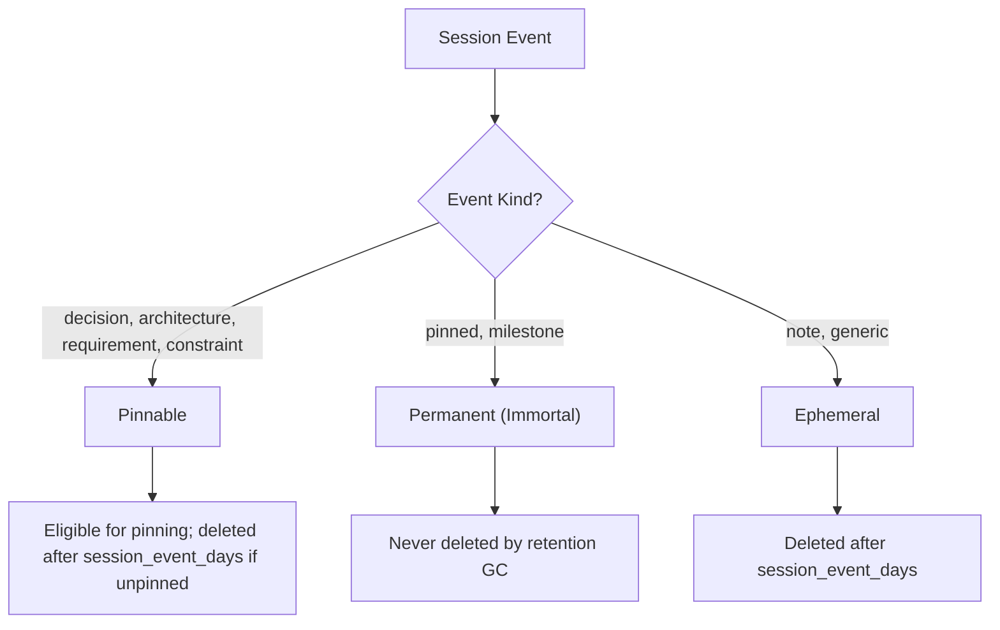

# Explanation: Retention & Memory Model

This document explains Context Kernel's memory retention architecture, the classification of session events, the guarantees provided for pinned memories, and the mechanics of startup garbage collection.

---

## 1. Why Tiered Memory Classification?

### The Problem
AI coding sessions generate a mixture of high-value architectural decisions and disposable conversational noise:
* **High-Value**: *"We decided to use SQLite WAL mode to support concurrent readers without deadlocks."* (Needs to survive indefinitely).
* **Low-Value / Noise**: *"Here is the output of `ls -la target/`."* (Irrelevant after the current work step).

Treating all session events equally results in either unbounded database bloat or premature loss of critical architectural context.

### The Solution: Three Retention Classes
`ck-memory::classify_event_kind` partitions events into three tiers:



---

## 2. The Pinned Event Guarantee

Context Kernel establishes a non-negotiable invariant:

> **Pinned events (`pinned = 1`) are never deleted by automated retention sweeps.**

When `AppServices::run_retention_gc` executes, its SQL queries explicitly filter out pinned events:
```sql
DELETE FROM session_events
WHERE created_at < ? AND pinned = 0
```
This guarantees that teams and autonomous agents can flag foundational requirements, constraints, or decisions as pinned, confident that maintenance sweeps will never discard them.

The same guard applies beyond individual events: a session that still contains a pinned event is not deleted with its inactive-session sweep (deleting it would cascade to the pinned event), and an artifact referenced by a pinned event is neither deleted nor has its payload removed.

---

## 3. Data Integrity & Compensation in Artifact Storage

### Two-Phase Persistence Risk
Storing an event with an offloaded payload involves two distinct operations:
1. Writing the binary payload file to `<data_dir>/artifacts/<artifact_id>.bin`.
2. Inserting the metadata row into SQLite's `artifacts` and `session_events` tables.

If step 1 succeeds but step 2 fails (e.g. SQLite database locked, disk full, or unique constraint violation), an orphaned file would remain on disk forever without any database pointer.

### Compensation Strategy
Context Kernel implements compensating rollback logic in `AppServices::store_context`:
```rust
let artifact = self.artifact_store.store_artifact(...)?;
if let Err(e) = self.storage.upsert_artifact(&artifact) {
    // Compansate: delete file immediately on metadata failure
    let _ = self.artifact_store.delete_artifact_payload(&artifact.artifact_id);
    return Err(e);
}
```
If metadata insertion fails, Context Kernel immediately deletes the created disk payload, preserving strict synchronization between the filesystem and SQLite.

---

## 4. Retention GC Scope & Frequency

Retention GC is designed as a **startup sweep** rather than an aggressive, constantly running background loop.
* **Why Startup?** Running retention cleanup on startup amortizes disk IO costs during service initialization and avoids write contention against active agent sessions.
* **GC Coverage**:
  - Unpinned session events older than `session_event_days` (default: 90 days)
  - Closed/compacted sessions older than `inactive_session_days` (default: 30 days)
  - Finished refresh jobs older than `refresh_job_days` (default: 30 days)
  - Artifact metadata and payload files older than `artifact_days` (default: 90 days)
  - Disabled sources older than `disabled_source_days` (default: 30 days)
