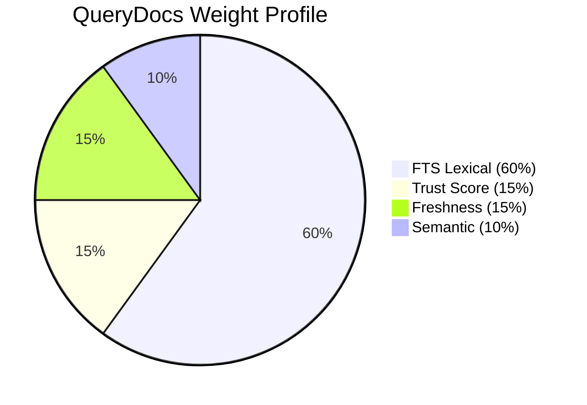
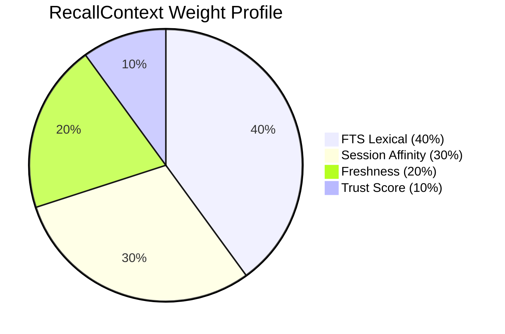

# Explanation: Retrieval & Ranking Design

This document explains the technical rationale behind Context Kernel's retrieval and ranking architecture, including token-efficient excerpts, intent-weighted hybrid ranking, SQLite BM25 score inversion, and result de-duplication.

---

## 1. Why Token-Efficient Excerpts Instead of Full Pages

### The Problem
Most naive agentic retrieval tools fetch full HTML pages or long Markdown files and inject them directly into the agent's prompt context. This leads to three severe failure modes:
1. **Context Window Exhaustion**: Multi-thousand-line documents rapidly consume the agent's token budget.
2. **Attention Degradation (Lost-in-the-Middle)**: Large language models demonstrate reduced attention accuracy on facts located in the middle of massive prompt texts.
3. **Noise and Distraction**: Extraneous navigation headers, footers, and unrelated APIs distract the agent from the exact signature or method it needs.

### The Solution
Context Kernel partitions documents into ~800-word chunks along structural heading lines (`#`, `##`, `###`). When an agent queries documentation, Context Kernel returns only the relevant chunks with explicit heading anchors and line citations.

---

## 2. Intent-Weighted Hybrid Ranking

### The Problem
No single scoring metric satisfies all retrieval use cases:
* When searching for an exact library by name (`ResolveLibrary`), matching an exact alias is far more important than semantic similarity or text length.
* When looking up API usage (`QueryDocs`), freshness and lexical keyword precision matter most.
* When recalling conversational memory (`RecallContext`), whether an event happened in the active session (`session_affinity`) is much more predictive than global keyword frequency.

### The Solution
Context Kernel introduces `QueryIntent` profiles in `ck-ranker`:

$$\text{CompositeScore} = w_{\text{fts}} S_{\text{fts}} + w_{\text{trust}} S_{\text{trust}} + w_{\text{freshness}} S_{\text{freshness}} + w_{\text{sem}} S_{\text{sem}} + w_{\text{aff}} S_{\text{aff}} + w_{\text{alias}} S_{\text{alias}}$$





---

## 3. SQLite BM25 Score Inversion

### Technical Detail
In SQLite's native FTS5 extension, the `bm25()` auxiliary function returns floating-point numbers where **lower values (more negative numbers) indicate better matches**, and values closer to 0 indicate poorer matches.

For example, a high-relevance match might return `-14.2`, while a weak match returns `-1.1`.

### Normalization in `ck-search-fts`
Because `LexicalRanker` combines lexical scores with other positive metrics (trust scores in $[0, 1]$, cosine similarities in $[0, 1]$, freshness scores in $[0, 1]$), `ck-search-fts` negates the SQLite BM25 output:
```rust
let score = -raw_score;
```
After negation, higher positive values represent higher relevance, allowing linear combination across all scoring dimensions.

---

## 4. Document-Level De-duplication

### The Problem
If a single long document (e.g. `axum::Router` documentation) mentions the search term "route" 50 times across 10 separate chunks, an unconstrained top-$K$ search might return 10 chunks from that single document, completely crowding out other relevant resources.

### The Solution
`LexicalRanker::deduplicate_by_document` groups candidate chunks by `document_id`. It preserves only the highest-scoring chunk for each document in the primary result set. This guarantees document diversity across the top results.

---

## 5. Freshness Scoring Rationale

Freshness is computed as a decay function comparing the document's `updated_at` timestamp against its configured `freshness_ttl_secs`. Documents that have exceeded their TTL receive degraded freshness scores during ranking, signaling to the ranker that more recently refreshed sources should take precedence.
