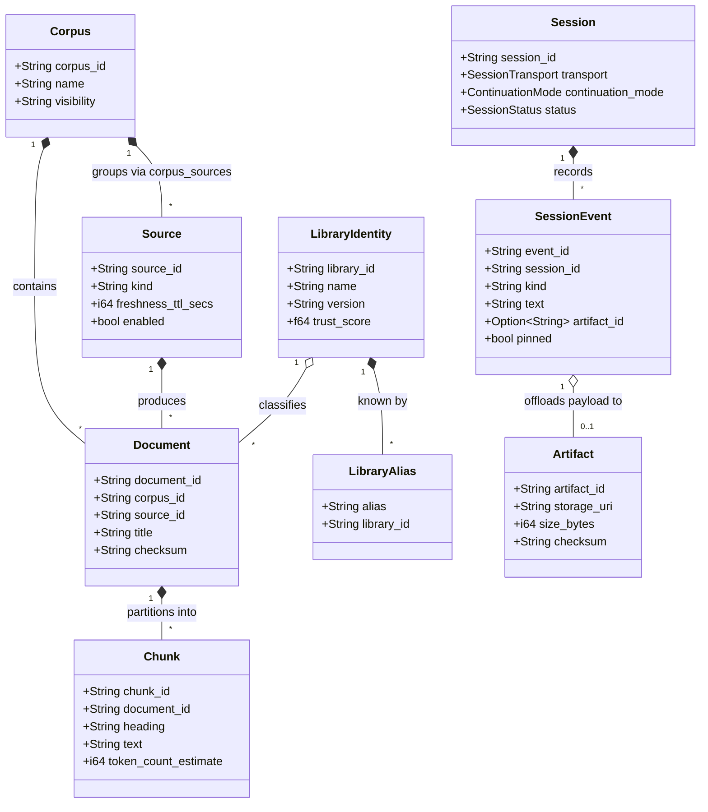

# System Mental Model

This document establishes the conceptual structure of Context Kernel. It explains the system's core responsibilities, operational boundaries, state ownership, lifecycle, and invariants before descending into implementation details.

---

## 1. What Context Kernel Is and Is Not

### The Analogy: An Operating System Buffer Cache for AI Agents
In a conventional operating system, a process does not read raw disk sectors or allocate infinite RAM for entire file systems. Instead, the OS maintains a page cache, resolves virtual paths to inode metadata, and serves small, bounded memory blocks on demand.

Context Kernel acts as the **contextual buffer cache and reference index** for an AI coding agent:
* An agent should not fetch multi-megabyte documentation pages into its prompt context. Context Kernel splits documentation into ~800-word chunks, indexes them with BM25, and serves compact excerpts with exact citations.
* An agent should not lose its memory across compaction or process restarts. Context Kernel provides durable session timelines with classified retention.
* An agent should not stuff large command outputs, compilation logs, or AST dumps into the prompt. Context Kernel offloads raw payloads to content-addressed artifact files and returns lightweight handles.

### Operational Boundaries

```text
┌─────────────────────────────────────────────────────────────────────────────┐
│                            What Context Kernel Owns                         │
├─────────────────────────────────────────────────────────────────────────────┤
│  ✓ Storing and recalling session context (decisions, requirements, notes)   │
│  ✓ Ingesting documentation from external sources (filesystem, web, github)  │
│  ✓ Indexing text with SQLite FTS5 (BM25 lexical retrieval)                  │
│  ✓ Intent-weighted hybrid ranking of search results                         │
│  ✓ Content-addressed filesystem artifact offloading                         │
│  ✓ Serving standard MCP tools over local stdio and remote SSE HTTP          │
│  ✓ Enforcing bearer token validation and tool/corpus allowlist policies     │
│  ✓ Resolving citations into ContextPacketCreated for SWE_SEED (E2/E3 edge)  │
└─────────────────────────────────────────────────────────────────────────────┘

┌─────────────────────────────────────────────────────────────────────────────┐
│                       What Context Kernel Does NOT Own                      │
├─────────────────────────────────────────────────────────────────────────────┤
│  ✗ Agent workflow orchestration (SWE_SEED owns software-work execution)     │
│  ✗ Consequential runtime action authorization (SEA-Forge owns authority)    │
│  ✗ Multi-tenant user accounts, billing, or SaaS metering                    │
│  ✗ Arbitrary code execution or sandboxed bash evaluation                    │
│  ✗ Distributed clustering or cross-node synchronization                     │
│  ✗ External heavy vector databases (uses embedded SQLite brute-force search)│
└─────────────────────────────────────────────────────────────────────────────┘
```

---

## 2. Core Responsibilities & Authority Boundaries

The canonical responsibility model in the wider GodSpeed ecosystem is summarized in [`docs/agentic_loop_boundaries.md`](agentic_loop_boundaries.md):

> **Know through Context Kernel. Work through SWE_SEED. Act through SEA-Forge.**

Context Kernel is the **contextual authority**:
* It answers: *"What does the agent need to know for this job?"*
* It returns the smallest sufficient working context with citations and provenance.
* It does **not** decide whether the agent is allowed to modify production code or execute an action. In the E2/E3 boundary (`context_required`), Context Kernel resolves context packets and attaches verified prior authority references; it never creates authority decisions.

---

## 3. Major Abstractions & Relationships



### Explanation of Abstractions
* **Corpus**: A logical administrative partition (e.g., `core_docs`, `team_decisions`). Clients are authorized at the corpus level via `allow_corpora`.
* **Source**: An operational origin of documentation (e.g., a local directory path). Governed by a refresh TTL. When refreshed, prior documents from that source are purged and replaced cleanly.
* **Document**: A single cohesive file or web resource with an immutable SHA-256 checksum.
* **Chunk**: An indexed text unit (~800 tokens max). Chunks are the primary unit of lexical (FTS5) and semantic retrieval.
* **Library Identity & Alias**: Normalizes colloquial library references (e.g., `reqwest` or `axum`) so agents get exact version-matched documentation.
* **Session & Session Event**: A chronological memory ledger. Events represent decisions, constraints, or milestones.
* **Artifact**: A content-addressed binary/text file stored in `<data_dir>/artifacts/<artifact_id>.bin` to prevent context pollution.

---

## 4. State Ownership & Persistence

All persistent state in Context Kernel falls into two strictly separated domains:

1. **Relational & Search State (SQLite database file `kernel.db`)**:
   - Schema version 1 installed via embedded DDL (`SCHEMA_V1`).
   - SQLite configured with `PRAGMA journal_mode=WAL; PRAGMA foreign_keys=ON; PRAGMA synchronous=NORMAL;`.
   - Tables store metadata for sources, corpora, documents, chunks, libraries, sessions, events, and jobs.
   - Virtual tables (`chunks_fts`, `session_events_fts`, `library_aliases_fts`) provide SQLite FTS5 full-text indexing with the `unicode61` tokenizer.
   - Vector tables (`chunk_embeddings`, `session_event_embeddings`) store raw binary float vectors.

2. **Payload State (Filesystem directory `<data_dir>/artifacts/`)**:
   - Files named `<artifact_id>.bin` (raw binary/text bytes) and `<artifact_id>.meta.json` (metadata).
   - Validated against path-traversal attacks by strictly requiring alphanumeric, `-`, and `_` characters in `artifact_id`.

3. **In-Memory Configuration State**:
   - Loaded from TOML file with environment variable expansion (`${ENV_VAR}`).
   - Wrapped in `Arc<RwLock<ReloadableSseState>>` to permit live configuration reload without dropping in-flight HTTP connections.

---

## 5. System Invariants

The following invariants are enforced throughout the repository and must not be violated:

1. **Causal Lineage & Provenance**: Every retrieved chunk links back to its parent `document_id`, `source_id`, `corpus_id`, and URI. Every `ContextPacketCreated` event emitted on the E2/E3 boundary references the initiating `event_id` as `caused_by:`.
2. **Pinned Memory Immortality**: Retention garbage collection (`run_retention_gc`) will delete unpinned session events older than `session_event_days`, but events with `pinned = 1` are **never** deleted by retention sweeps.
3. **No Phantom Artifacts**: If writing artifact metadata to SQLite fails during context storage, the physical payload file on disk is immediately deleted via a compensation step to prevent orphaned disk growth.
4. **Source Refresh Non-Accumulation**: Refreshing a source deletes all prior documents and chunks generated by that source before inserting the new units. Refreshes do not accumulate stale duplicate chunks.
5. **Fail-Closed SSRF Protection**: The Web adapter blocks all private IPv4 ranges (10.0.0.0/8, 172.16.0.0/12, 192.168.0.0/16, 127.0.0.0/8, 169.254.0.0/16, 0.0.0.0/8), IPv6 loopback and link-local addresses, non-HTTP schemes, and DNS hostnames that resolve to empty or private IPs.
6. **Constant-Time Token Comparison**: All authentication tokens are compared using `subtle::ConstantTimeEq` to prevent timing attacks.
7. **Single-Binary Delivery**: The entire service compiles into one self-contained binary (`context-kernal`), embedding all SQLite migration SQL and default configurations.
