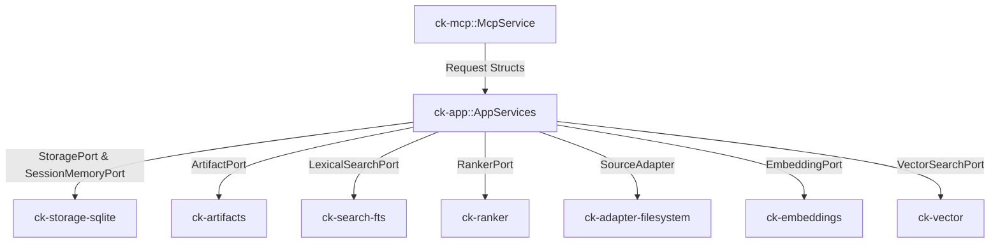

# Subsystem: Application Orchestration

The Application Orchestration subsystem consists of `ck-app`. It implements `AppServices`, the central orchestrator that coordinates domain ports to execute the primary use cases of Context Kernel.

---

## 1. Purpose
`AppServices` is the application layer. It sits between incoming protocol requests (from `ck-mcp` or CLI) and outgoing infrastructure adapters (storage, search, ranking, artifacts, sources). It enforces transactional workflows, calculates composite metrics, and ensures business invariants are preserved across storage boundaries.

---

## 2. Responsibilities
* Coordinate use-case execution for:
  - `store_context`: Stores session events and manages artifact offloading.
  - `recall_context`: Recalls prior session events matching a query with session affinity.
  - `ingest_source`: Ingests an external documentation source, normalizes content, chunks text, and indexes in SQLite and FTS5.
  - `refresh_source`: Re-indexes an existing source, cleanly replacing prior documents without accumulation.
  - `query_reference`: Executes hybrid retrieval, intent-weighted ranking, and de-duplicated citation generation.
  - `resolve_reference`: Resolves library queries to canonical identities using FTS and alias exact-matching.
  - `get_status`: Aggregates service, storage, source, session, job, and retrieval counts.
  - `run_retention_gc`: Executes scheduled garbage collection across unpinned events, inactive sessions, jobs, artifacts, and disabled sources.

---

## 3. Non-Responsibilities
* **No Transport Parsing**: Does not handle JSON-RPC framing, HTTP request headers, or SSE streaming; accepts strongly-typed request structs and returns response structs.
* **No Direct SQL Execution**: Communicates with persistence exclusively through `StoragePort`, `SessionMemoryPort`, and `LexicalSearchPort`.

---

## 4. Position in the System
`ck-app` sits at the center of the architecture, directly invoked by `ck-mcp` and driving all adapters via `ck-core` ports.



---

## 5. Core Abstractions

### `AppServices` ([`crates/ck-app/src/lib.rs`](../../crates/ck-app/src/lib.rs#L15-L26))
The struct holds boxed trait objects for all ports:
```rust
pub struct AppServices {
    storage: Box<dyn StoragePort>,
    session_memory: Box<dyn SessionMemoryPort>,
    artifact_store: Box<dyn ArtifactPort>,
    search: Box<dyn LexicalSearchPort>,
    ranker: Box<dyn RankerPort>,
    source_adapter: Box<dyn SourceAdapter>,
    normalizer: Box<dyn Normalizer>,
    chunker: Box<dyn Chunker>,
    embedding: Option<Box<dyn EmbeddingPort>>,
    vector_search: Option<Box<dyn VectorSearchPort>>,
    kind_adapters: Vec<(String, Box<dyn SourceAdapter>)>,
    context_effects: Option<Arc<ContextEffectStore>>,
}
```

### Request & Response DTOs
Every use case is represented by explicit, strongly typed request and response pairs:
* `StoreContextRequest` / `StoreContextResponse`
* `RecallContextRequest` / `RecallContextResponse`
* `IngestSourceRequest` / `IngestSourceResponse`
* `RefreshSourceRequest` / `RefreshSourceResponse`
* `QueryReferenceRequest` / `QueryReferenceResponse`
* `ResolveReferenceRequest` / `ResolveReferenceResponse`
* `ContextRequirement` / `ContextResolution` (context pipeline)
* `Vec<ContextEffect>` / `ContextEffectIngestReport` (calibration)
* `RetentionPolicy` / `RetentionGcReport`

---

## 6. Internal Operation

### Context Storage & Artifact Offloading (`store_context`)
1. Verifies that the target session exists; if missing, auto-creates it with default settings.
2. Checks if an `artifact_content` payload is present:
   - If present, writes the raw bytes to the artifact store (`ArtifactPort::store_artifact`).
   - If storing artifact metadata in SQLite fails, `AppServices` executes a compensating delete (`ArtifactPort::delete_artifact_payload`) so orphan files never leak.
3. Inserts the `SessionEvent` into SQLite.
4. Indexes the event text in `session_events_fts` for future recall.

### Documentation Refresh & Non-Accumulation (`refresh_source`)
1. Fetches the existing `Source` metadata.
2. Identifies all documents previously produced by this source (`StoragePort::list_documents_by_source`).
3. For each existing document:
   - Removes its chunks from the FTS5 index (`LexicalSearchPort::remove_chunks_by_document`).
   - Deletes the document from SQLite (foreign key cascades automatically delete canonical chunks).
4. Re-discovers units and re-ingests the source, generating fresh document and chunk records.
5. Re-indexes the new chunks in FTS5.
6. Updates source timestamps (`last_refresh_success_at`, `updated_at`).

### Intent-Weighted Reference Retrieval (`query_reference`)
1. Resolves target corpora from `source_scope`.
2. Rejects a private corpus that is not covered by the caller scope.
3. Queries FTS5 for top lexical matches using SQLite BM25.
4. If semantic embeddings are configured, queries SQLite vector store for cosine similarity.
5. Calls `RankerPort::rank_results`, applying the intent's `WeightProfile`.
6. De-duplicates results by `document_id`.
7. Resolves parent document metadata to construct citations with line and heading anchors.

### Bounded Context Resolution (`resolve_context`, `crates/ck-app/src/context.rs`)
The eight-stage pipeline used by `context_required`:
1. **Data access**: exclusions and POL-ACL-002 scope enforcement run before retrieval. Refusal yields `requires_scope` or `inaccessible` with reason `corpus_scope_unresolved` or `corpus_excluded`.
2. **Retrieval**: queries each requested corpus, merges candidates, sorts by score.
3. **Freshness**: drops results older than `freshness.max_age_secs`; unknown age is never stale.
4. **Budget**: enforces `max_results` and an optional token ceiling, recording `max_results_reached` or `token_budget_exhausted`.
5. **Availability**: unregistered requested corpora become `corpus_not_found` omissions.
6. **Required concepts**: absent concepts become `required_distinction_absent` omissions. An empty kept set selects the reason by fixed precedence: `budget_exhausted`, `no_fresh_content`, `corpus_not_found`, `no_matching_content`.
7. **Calibration**: reads the per-world effect ledger, multiplies affected scores by `1 - penalty`, caps penalties at 0.50, and re-sorts.
8. **Verdict**: no omissions means `Complete`; any omission means `Partial`; no references means `None`.

### Effect Ingestion (`ingest_context_effects`)
Validates each `ContextEffect` (pinned `world_ref`, `sha256:` bundle hash, settlement-backed `evidence_ref`) and appends it to the world's JSONL ledger. Re-ingest is idempotent by `effect_id`; rejected records are counted, never silently dropped.

---

## 7. State
`AppServices` holds no request-scoped mutable state. It owns immutable trait objects (`Box<dyn Port>`), a kind-indexed adapter list, and an optional `Arc<ContextEffectStore>`. Durable state lives in SQLite, the artifact directory, or the per-world effect ledger.

---

## 8. Lifecycle
Constructed in `main.rs::wire_app` during service startup and wrapped in an `Arc<McpService>`. Reconstructed dynamically when hot configuration reload is triggered.

---

## 9. Failure Modes
* **Partial Ingestion**: If an individual document fails during ingestion, `AppServices` logs a warning and marks the source `SourceHealth::Degraded`, recording the error in `last_refresh_error`.
* **Artifact Compensation**: If metadata persistence fails after disk write, the compensating delete ensures disk cleanliness.
* **Semantic Failure**: If the embedding provider fails or is unconfigured, queries automatically fall back to pure lexical search.

---

## 10. Extension Points
* **Semantic Retrieval Toggle**: `AppServices::with_semantic(embedding, vector_search)` enables vector search dynamically.
* **Additional Use Cases**: New domain workflows (e.g., bulk document export) can be implemented directly on `AppServices`.

---

## 11. Source Trail
* `crates/ck-app/src/lib.rs` — `AppServices` definition (L21), `adapter_for_kind` (L176), `run_retention_gc` (L62), `store_context` (L206), `recall_context` (L339), `ingest_source` (L393), `query_reference` (L590), `resolve_reference` (L1840), `refresh_source` (L1934), `get_status` (L1964).
* `crates/ck-app/src/context.rs` — `ContextRequirement` (L69), `ContextAccess` (L120), `resolve_context` (L245), `ingest_context_effects` (L579).
* `crates/ck-app/src/context_effect.rs` — effect validation, per-world summary, penalty cap.
