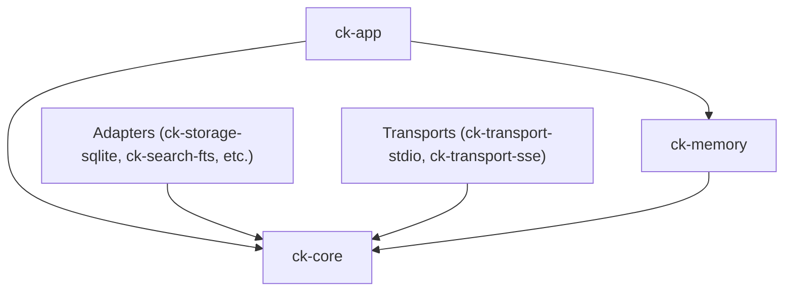

# Subsystem: Core & Domain

The Core and Domain subsystem comprises `ck-core` and `ck-memory`. It defines the fundamental data structures, port traits, and domain policies that govern Context Kernel, completely isolated from infrastructure, transport, or persistence mechanisms.

---

## 1. Purpose
This subsystem exists to provide a stable, zero-infrastructure domain model. By encapsulating entity definitions and abstract port traits in `ck-core`, Context Kernel ensures that business logic and use cases remain decoupled from SQLite, HTTP, FTS5, or external APIs.

---

## 2. Responsibilities
* Define authoritative domain entities (`Source`, `Corpus`, `Document`, `Chunk`, `LibraryIdentity`, `LibraryAlias`, `Session`, `SessionEvent`, `Artifact`, `RefreshJob`).
* Define contract traits (ports) for all infrastructure boundaries:
  - `StoragePort` & `SessionMemoryPort`
  - `LexicalSearchPort` & `VectorSearchPort`
  - `RankerPort` & `EmbeddingPort`
  - `ArtifactPort`
  - `SourceAdapter`, `Normalizer`, `Chunker`
  - `AuthPort` & `SchedulerPort`
* Provide domain enums and status representations (`RetrievalMode`, `SessionTransport`, `ContinuationMode`, `SessionStatus`, `JobTrigger`, `JobStatus`, `QueryIntent`, `RecallScope`, `SourceHealth`).
* Provide event retention classification and memory policies via `ck-memory` (`EventRetentionClass`, `SessionRetentionPolicy`).

---

## 3. Non-Responsibilities
* **No SQL or Database Access**: Does not open database connections or construct SQL queries.
* **No HTTP or Serialization Protocols**: Does not parse MCP JSON-RPC messages or manage TCP listeners.
* **No Filesystem Operations**: Does not read or write disk files directly.
* **No External Network Calls**: Does not invoke third-party embedding APIs.

---

## 4. Position in the System
`ck-core` is the root dependency for the entire repository. All functional crates depend on `ck-core`, but `ck-core` depends on none of them.



---

## 5. Core Abstractions

### Entities ([`crates/ck-core/src/entities/`](../../crates/ck-core/src/entities/))
* `Source`: Ingestion origin configuration, health status, and freshness TTL.
* `Corpus`: Access-control and query-scoping boundary.
* `Document`: Normalised document record with SHA-256 checksum.
* `Chunk`: Bounded text section (~800 tokens max) with heading metadata.
* `Session`: Timeline container for agent interactions.
* `SessionEvent`: Discrete timestamped memory record (decision, architecture, note).
* `Artifact`: Content-addressed disk payload descriptor.

### Ports ([`crates/ck-core/src/ports/`](../../crates/ck-core/src/ports/))
* `StoragePort`: CRUD operations across all entity types, plus retention sweep queries.
* `SessionMemoryPort`: Dedicated interface for active session counting and event queries.
* `LexicalSearchPort`: Indexing and BM25 lexical querying of chunks and events.
* `RankerPort`: Combining lexical scores, vector scores, trust scores, and freshness into a unified rank.
* `ArtifactPort`: Writing and reading binary/text payload files.

### Memory Classification ([`crates/ck-memory/src/lib.rs`](../../crates/ck-memory/src/lib.rs))
* `EventRetentionClass`: Categorizes event kinds into `Permanent`, `Pinnable`, or `Ephemeral`.
  ```rust
  pub fn classify_event_kind(kind: &str) -> EventRetentionClass {
      match kind {
          "decision" | "architecture" | "requirement" | "constraint" => EventRetentionClass::Pinnable,
          "pinned" | "milestone" => EventRetentionClass::Permanent,
          _ => EventRetentionClass::Ephemeral,
      }
  }
  ```

---

## 6. Internal Operation
The domain crate operates purely as value objects and stateless functions:
1. Port traits use standard `anyhow::Result` error types to allow adapters to propagate underlying errors cleanly.
2. Trait methods accept immutable borrows (`&self`, `&Entity`) to facilitate thread-safe sharing (`Send + Sync`).
3. Enums implement `serde::Serialize` and `serde::Deserialize` with `snake_case` renaming to establish a clean protocol contract with zero transport code.

---

## 7. State
`ck-core` and `ck-memory` are strictly **stateless**. They hold no global locks, static mutables, or in-memory caches.

---

## 8. Lifecycle
Instantiated and invoked during every use-case execution. Value objects are created at adapter boundaries, manipulated by `ck-app`, and persisted through `StoragePort`.

---

## 9. Failure Modes
Since there is no IO or unsafe code, domain failures are restricted to domain validation:
* **Unparseable Enum Variants**: If stored strings in SQLite or incoming JSON do not match enum variants, deserialization errors are returned.
* **Invariant Breaches**: Addressed at adapter entry points before domain entities are constructed.

---

## 10. Extension Points
* **Adding an Entity**: Add the struct in `crates/ck-core/src/entities/` and export in `mod.rs`.
* **Adding a Port**: Define a new trait in `crates/ck-core/src/ports/` and wire into `AppServices`.
* **Adding a Memory Category**: Update `classify_event_kind` in `crates/ck-memory/src/lib.rs`.

---

## 11. Source Trail
* `crates/ck-core/src/lib.rs` — Root module and prelude.
* `crates/ck-core/src/entities/` — Entity definitions (`source.rs`, `document.rs`, `chunk.rs`, `session.rs`, `artifact.rs`).
* `crates/ck-core/src/ports/` — Abstract port traits (`storage.rs`, `lexical_search.rs`, `ranker.rs`, `artifact.rs`).
* `crates/ck-core/src/types/mod.rs` — Domain enums (`RetrievalMode`, `QueryIntent`, `JobStatus`).
* `crates/ck-memory/src/lib.rs` — `classify_event_kind` and `SessionRetentionPolicy`.
