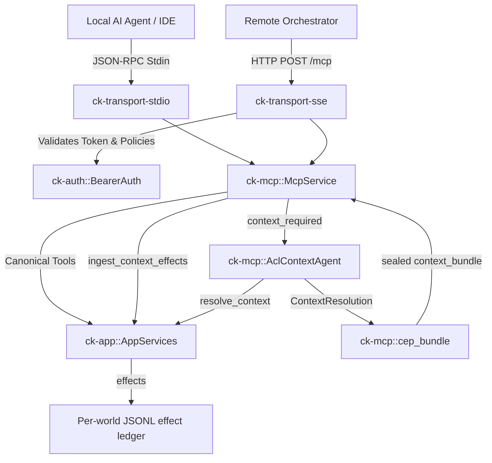

# Subsystem: MCP & Protocol Serving

The MCP & Protocol Serving subsystem consists of `ck-mcp`, `ck-transport-stdio`, `ck-transport-sse`, and `ck-auth`. It exposes the service's capabilities to AI agents and external orchestrators over standard Model Context Protocol (MCP) transports.

---

## 1. Purpose
This subsystem is Context Kernel's public interface. It parses incoming JSON-RPC 2.0 requests over standard input or HTTP Server-Sent Events (SSE), enforces bearer authentication and tool/corpus authorization policies, dispatches calls to canonical tool handlers, and serves the frozen agentic capability loop E2/E3 boundary (`context_required`).

---

## 2. Responsibilities
* Implement `McpService` in `ck-mcp`, dispatching canonical MCP tools and compatibility aliases.
* Enforce security policies:
  - Validate bearer tokens using constant-time comparison (`subtle::ConstantTimeEq`).
  - Authorize tool execution against `allow_tools`.
  - Authorize corpus access against `allow_corpora`.
* Implement `AclContextAgent` in `ck-mcp::agentic_capability_loop`, serving the frozen E2/E3 convergence boundary with SWE_SEED.
* Implement `handle_line` in `ck-transport-stdio` for line-delimited JSON-RPC 2.0 handling over stdin/stdout.
* Implement `serve_sse` in `ck-transport-sse` using Axum, providing `/mcp`, `/healthz`, `/readyz`, and `/api/v1/status`.
* Support zero-downtime hot reload via `ReloadableSseState`.

---

## 3. Non-Responsibilities
* **No Direct File or Database IO**: All domain operations are delegated to `AppServices`.
* **No Action Authority Creation**: Context Kernel never creates `AuthorityChecked` decisions; SEA-Forge owns action authority.

---

## 4. Position in the System
This subsystem forms the inbound driving adapter layer of Context Kernel.



---

## 5. Core Abstractions

### `McpService` ([`crates/ck-mcp/src/lib.rs`](../../crates/ck-mcp/src/lib.rs#L57-L148))
* Dispatches tool calls by name:
  - Canonical tools: `get_status`, `store_context`, `recall_context`, `ingest_source`, `refresh_source`, `query_reference`, `resolve_reference`, `context_required`, `ingest_context_effects`.
  - Compatibility aliases: `resolve-library-id` (maps to `resolve_reference`), `get-library-docs` & `query-docs` (map to `query_reference`).
* Emits structured tracing for every tool execution:
  ```rust
  tracing::info!(tool_name = name, duration_ms = elapsed, outcome = "success", "tool call completed");
  ```

### `BearerAuth` ([`crates/ck-auth/src/lib.rs`](../../crates/ck-auth/src/lib.rs))
* Validates tokens in constant time:
  ```rust
  let token = token.strip_prefix("Bearer ").unwrap_or(token);
  self.valid_tokens.iter().any(|t| t.as_bytes().ct_eq(token.as_bytes()).into())
  ```
* Evaluates tool and corpus allowlists (`["*"]` allows all).

### `AclContextAgent` ([`crates/ck-mcp/src/agentic_capability_loop.rs`](../../crates/ck-mcp/src/agentic_capability_loop.rs))
* Handles the frozen E2/E3 boundary.
* Ingress gate: Validates canonical v1 envelope, asserts `source_agent == "swe_seed"`, verifies `domain_model_hash` is a 64-char lowercase SHA-256 (rejecting `FALLBACK_PSEUDO_HASH` or all-zero placeholders fail-closed).
* Corpus resolution: an operator-configured corpus is auto-ingested exactly once; a caller-declared private corpus is never auto-ingested open, and any other unregistered corpus yields an explicit no-context reason.
* Retrieval: delegates to `AppServices::resolve_context`, which runs the eight stages (access, retrieval, freshness, budget, availability, required concepts, calibration, verdict).
* Egress: projects the `ContextResolution` into a CEP `godspeed.context_bundle` stamped with `created_by: "context-kernel"` and `caused_by: <request_event_id>`. `assemble` enforces the truthfulness rules and stamps `integrity` last. The legacy `ContextPacketCreated` envelope and packet payload are still returned for dual-read migration and are marked deprecated.
* Access semantics: `access` reports `accessible`, `inaccessible` (with `excluded` or `out_of_scope`), or `requires_scope`. It never conveys action authority.

### `ReloadableSseState` ([`crates/ck-transport-sse/src/lib.rs`](../../crates/ck-transport-sse/src/lib.rs#L15-L43))
* Wraps `Arc<McpService>` and `Arc<dyn AuthPort>` in `RwLock` structures.
* When configuration is reloaded, the active service and auth policy are replaced atomically without restarting the Axum HTTP server.

---

## 6. Internal Operation

### SSE Request Pipeline (`POST /mcp`)
1. Axum extracts the `Authorization` header.
2. If `require_auth = true` and `auth.is_local_trust_mode() == false`, token presence and constant-time equality are verified. Returns HTTP 401 on failure.
3. Deserializes JSON body into a JSON-RPC 2.0 object.
4. Checks that `params.name` is allowed by `auth.authorize_tool`.
5. Extracts any `corpus_id` or `source_scope` from arguments and checks `auth.authorize_corpus`.
6. Dispatches to `McpService::call_tool`.
7. Returns HTTP 200 with standard JSON-RPC 2.0 result or error.

### Health and Readiness Probing
* `GET /healthz`: Returns `{"status": "ok"}` (liveness).
* `GET /readyz`: Actively probes `mcp.call_tool("get_status", json!({}))`. Returns `{"ready": true}` if the application core is initialized and capable of dispatching queries.
* `GET /api/v1/status`: Dispatches `get_status` and returns full service statistics.

---

## 7. State
* In Stdio mode: `McpService` is held in the main thread loop.
* In SSE mode: `ReloadableSseState` manages thread-safe readers via `RwLock`.

---

## 8. Lifecycle
* Stdio loop runs synchronously on stdin until EOF.
* SSE server runs asynchronously inside a spawned Tokio runtime thread until process termination.

---

## 9. Failure Modes
* **Unknown Tool**: Returns MCP error `McpError::UnknownTool`.
* **Unauthorized Tool or Corpus**: Returns MCP error `McpError::InvalidArguments("unauthorized tool: ...")`.
* **Missing Bearer Token**: Returns HTTP 401 with `{"error": {"code": "auth_required", "message": "Unauthorized"}}`.
* **Malformed E2 Envelope**: Fails closed with invalid arguments error explaining the contract violation.

---

## 10. Extension Points
* **New MCP Tools**: Register a new branch in `McpService::dispatch_tool` and implement handler.
* **Alternative Transport**: Add a new transport adapter calling `McpService::call_tool`.

---

## 11. Source Trail
* `crates/ck-mcp/src/lib.rs` — `McpService` (L57), `call_tool` (L106), `dispatch_tool` (L120), `handle_store_context` (L185), `handle_recall_context` (L239), `handle_ingest_source` (L283), `handle_query_reference` (L320), `handle_resolve_reference` (L384), `handle_ingest_context_effects` (L441), `handle_context_required` (L476), `handle_refresh_source` (L572).
* `crates/ck-mcp/src/agentic_capability_loop.rs` — ingress gates (L51, L91), `acquire_context` (L288), `ensure_corpus_ingested` (L420).
* `crates/ck-mcp/src/cep_bundle.rs` — `canonical_json` (L70), `assemble` (L179), `project_context_bundle` (L345).
* `crates/ck-mcp/src/agentic_capability_loop.rs` — `AclContextAgent`, `verify_domain_identity` (L51), `acquire_context`.
* `crates/ck-auth/src/lib.rs` — `BearerAuth`, `validate_token` (L54), `authorize_tool`, `authorize_corpus`.
* `crates/ck-transport-stdio/src/lib.rs` — `handle_line` (L5).
* `crates/ck-transport-sse/src/lib.rs` — `serve_sse` (L45), `ReloadableSseState` (L15), `/readyz` probe (L66).
