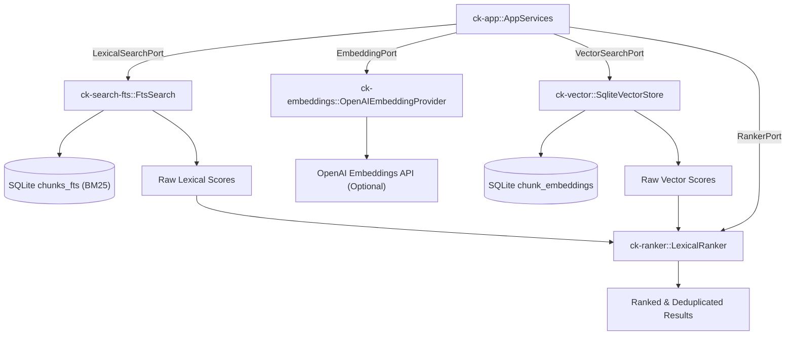

# Subsystem: Retrieval & Ranking

The Retrieval & Ranking subsystem consists of `ck-search-fts`, `ck-ranker`, and `ck-embeddings`. It provides full-text lexical search with SQLite FTS5, intent-weighted hybrid ranking, result de-duplication, and optional vector embeddings.

---

## 1. Purpose
AI coding agents require precise, version-aware reference citations without bloating prompts with multi-page documentation dumps. This subsystem indexes text chunks, searches them using SQLite's BM25 algorithm, combines lexical and semantic signals using query intent profiles, and returns compact, de-duplicated excerpts.

---

## 2. Responsibilities
* Implement `LexicalSearchPort` via `FtsSearch` in `ck-search-fts`, querying the `chunks_fts`, `session_events_fts`, and `library_aliases_fts` virtual tables.
* Normalize SQLite FTS5 BM25 scores (inverting the negative values returned by SQLite's `bm25()` function).
* Implement `RankerPort` via `LexicalRanker` in `ck-ranker`, applying intent-specific weight profiles across lexical, trust, freshness, semantic, session affinity, and alias match signals.
* De-duplicate chunk matches belonging to the same document, keeping the highest-scoring chunk or citation per document.
* Implement `EmbeddingPort` via `OpenAIEmbeddingProvider` and `NoopEmbeddingProvider` in `ck-embeddings`.

---

## 3. Non-Responsibilities
* **No Raw Content Storage**: Does not store the canonical relational documents or chunks; relies on SQLite tables managed by `ck-storage-sqlite`.
* **No Ingestion Coordination**: Does not read directories or fetch web pages; indexes text supplied to it by `ck-app`.
* **No Tool Serialization**: Does not construct MCP responses; returns sorted `RetrievalResult` and `ResolvedCandidate` domain structures.

---

## 4. Position in the System
The retrieval subsystem is invoked by `ck-app::AppServices` during `query_reference`, `resolve_reference`, and `recall_context`.



---

## 5. Core Abstractions

### `FtsSearch` ([`crates/ck-search-fts/src/lib.rs`](file:///crates/ck-search-fts/src/lib.rs))
* Manages queries against SQLite FTS5 virtual tables.
* Constructs sanitized FTS queries: tokens are quoted with double-quotes (`"token"`), internal quotes are escaped (`""`), and tokens are joined with `OR`:
  ```rust
  fn fts_query(raw: &str) -> Option<String> {
      let result = raw.split_whitespace()
          .filter(|t| !t.is_empty())
          .map(|t| format!("\"{}\"", t.replace('"', "\"\"")))
          .collect::<Vec<_>>()
          .join(" OR ");
      if result.is_empty() { None } else { Some(result) }
  }
  ```
* Inverts SQLite's `bm25()` output: in SQLite FTS5, lower values indicate better matches (typically negative numbers). Context Kernel computes `score = -raw_score` so that higher values represent better matches across all ranking signals.

### `WeightProfile` & `LexicalRanker` ([`crates/ck-ranker/src/lib.rs`](file:///crates/ck-ranker/src/lib.rs))
* Context Kernel dynamically selects weights based on `QueryIntent`:

| Query Intent | FTS Lexical | Trust Score | Freshness | Semantic | Session Affinity | Alias Exact |
| :--- | :--- | :--- | :--- | :--- | :--- | :--- |
| **`ResolveLibrary`** | 0.50 | 0.30 | 0.10 | 0.00 | 0.00 | 0.10 |
| **`QueryDocs`** | 0.60 | 0.15 | 0.15 | 0.10 | 0.00 | 0.00 |
| **`SearchRefs`** | 0.50 | 0.10 | 0.20 | 0.20 | 0.00 | 0.00 |
| **`RecallContext`** | 0.40 | 0.10 | 0.20 | 0.00 | 0.30 | 0.00 |
| **`General`** | 0.70 | 0.20 | 0.10 | 0.00 | 0.00 | 0.00 |

### `LexicalRanker::deduplicate_by_document`
* When multiple chunks from the same document match a query, the ranker groups chunks by `document_id` and retains only the chunk with the highest composite score, preventing one large file from monopolizing all `top_k` slots.

### `OpenAIEmbeddingProvider` ([`crates/ck-embeddings/src/lib.rs`](file:///crates/ck-embeddings/src/lib.rs))
* Synchronous HTTP client built on `ureq::Agent`.
* Calls `/v1/embeddings` with bearer authentication. Supports custom `api_base`, `model` (e.g. `text-embedding-3-small`), and dimension truncation.

---

## 6. Internal Operation

### Reference Query Execution
1. `AppServices::query_reference` inspects the request. If no `source_scope` is provided, all authorized corpora are queried.
2. `FtsSearch::search_chunks` queries `chunks_fts` with BM25 ranking, scoped by `corpus_id`.
3. If semantic retrieval is enabled, `OpenAIEmbeddingProvider::embed` generates a query vector and `SqliteVectorStore::search_chunks` finds top cosine similarity chunks.
4. `LexicalRanker::rank_results` merges lexical scores, semantic scores, library trust scores, and document freshness scores using the intent's `WeightProfile`.
5. The ranker collapses results by `document_id` to ensure diversity.
6. The top $K$ results are enriched with parent document metadata (`StoragePort::get_chunk_with_document`) to construct complete citation objects.

---

## 7. State
* `ck-search-fts`: Stateless; opens SQLite connections on demand.
* `ck-ranker`: Pure computation; zero state.
* `ck-embeddings`: Holds immutable connection configuration and `ureq::Agent`.

---

## 8. Lifecycle
Stateless throughout runtime. Instantiated once in `main.rs::wire_app` and moved into `AppServices`.

---

## 9. Failure Modes
* **FTS5 Syntax Errors**: Prevented by `fts_query`, which strips raw boolean operators and quotes every token.
* **OpenAI API Unreachable / Timeout**: `OpenAIEmbeddingProvider` configures a 30s read timeout and 10s write timeout; failures degrade gracefully to pure lexical ranking without aborting the query.
* **Corrupted Virtual Tables**: If an FTS table is out of sync, `context-kernal rebuild-index` reindexes all chunks from the canonical `chunks` table.

---

## 10. Extension Points
* **Custom Intent Profiles**: Adjust or add new `WeightProfile` definitions in `ck-ranker`.
* **Alternative Embedding Providers**: Implement `EmbeddingPort` for local models (e.g. ONNX Runtime, FastEmbed, Ollama).
* **Reciprocal Rank Fusion (RRF)**: Replace weighted linear combination with RRF in `RankerPort`.

---

## 11. Source Trail
* `crates/ck-search-fts/src/lib.rs` — `FtsSearch`, `fts_query` sanitizer (L24), `collect_scored` BM25 negator (L38).
* `crates/ck-ranker/src/lib.rs` — `WeightProfile` (L8–L61), `combine_score` (L99), `deduplicate_by_document` (L140).
* `crates/ck-embeddings/src/lib.rs` — `OpenAIEmbeddingProvider`, `NoopEmbeddingProvider`.
