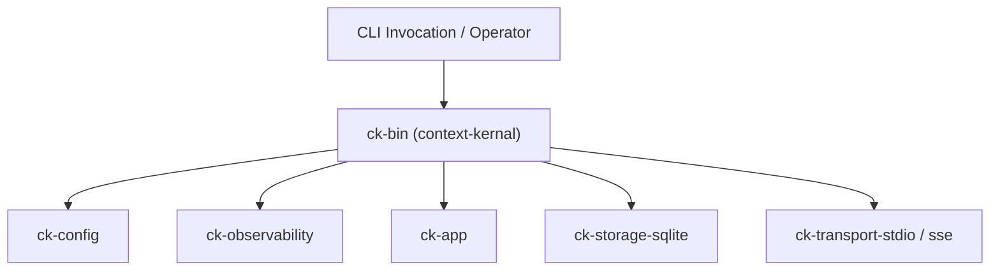

# Subsystem: Runtime & CLI

The Runtime & CLI subsystem consists of `ck-bin`, `ck-config`, `ck-observability`, and `ck-scheduler`. It serves as the application's composition root, command-line interface, configuration engine, and observability setup.

---

## 1. Purpose
This subsystem handles process bootstrap, command-line argument parsing, environment variable expansion, logging initialization, and the composition of all adapters into executable application services.

---

## 2. Responsibilities
* Implement the CLI binary entry point (`context-kernal`) via `clap` in `ck-bin`:
  - `serve`: Runs the MCP server over stdio and optionally SSE.
  - `migrate`: Runs SQLite database migrations.
  - `doctor`: Inspects database connectivity, path, and FTS5 availability.
  - `export-schema`: Dumps embedded SQLite schema DDL to stdout.
  - `rebuild-index`: Reindexes all FTS5 tables from canonical SQLite rows.
* Implement TOML configuration parsing and environment variable interpolation (`${ENV_VAR}`) in `ck-config`.
* Implement process-wide structured tracing in `ck-observability` (`text` and `json` output formats to stderr).
* Implement background refresh job scheduling in `ck-scheduler`.

---

## 3. Non-Responsibilities
* **No Business Logic**: Does not define domain entities or directly execute retrieval algorithms.
* **No Client Protocol Logic**: Delegates MCP framing to `ck-transport-stdio` and `ck-transport-sse`.

---

## 4. Position in the System
`ck-bin` is the composition root at the top of the repository hierarchy.



---

## 5. Core Abstractions

### `Cli` & `Commands` ([`crates/ck-bin/src/main.rs`](../../crates/ck-bin/src/main.rs#L22-L37))
Defines the top-level CLI commands using `clap`:
```rust
#[derive(Debug, Subcommand)]
enum Commands {
    Serve(RuntimeArgs),
    Migrate(RuntimeArgs),
    Doctor(RuntimeArgs),
    ExportSchema,
    RebuildIndex(RuntimeArgs),
}
```

### `KernelConfig` ([`crates/ck-config/src/lib.rs`](../../crates/ck-config/src/lib.rs#L8-L28))
Strongly typed configuration tree mapping top-level TOML tables (`[service]`, `[storage]`, `[retrieval]`, `[mcp]`, `[auth]`, `[scheduler]`, `[embeddings]`, `[reload]`, `[retention]`, `[authorization]`, `[observability]`).

### `init_observability` ([`crates/ck-observability/src/lib.rs`](../../crates/ck-observability/src/lib.rs#L20-L47))
Installs a `tracing_subscriber::fmt` subscriber globally (`tracing::subscriber::set_global_default`) writing to `std::io::stderr`. Spawned background threads (SSE runtime, refresh worker) automatically inherit this subscriber.

### `RefreshScheduler` ([`crates/ck-scheduler/src/lib.rs`](../../crates/ck-scheduler/src/lib.rs))
Implements `SchedulerPort`, providing atomic queueing, active job coalescing, and job claiming.

---

## 6. Internal Operation

### Bootstrap Sequence (`serve`)
1. Parses CLI flags via `Cli::parse()`.
2. Loads configuration from file (`load_config`) or falls back to `default_config()`. Overrides `database_path` if `--database` flag is provided.
3. Installs process-wide tracing via `init_logging(&config)`.
4. Opens `SqliteStore` and runs `store.migrate()`.
5. Composes all ports and adapters via `wire_app`:
   - `SqliteStore` (implements `StoragePort` and `SessionMemoryPort`)
   - `FileArtifactStore` (implements `ArtifactPort`)
   - `FtsSearch` (implements `LexicalSearchPort`)
   - `LexicalRanker` (implements `RankerPort`)
   - `FilesystemSourceAdapter` (implements `SourceAdapter`)
   - `MarkdownNormalizer` & `HeadingChunker`
   - Optional `OpenAIEmbeddingProvider` and `SqliteVectorStore`
6. Executes startup retention GC if `config.retention.enabled == true`.
7. Builds `McpService` with optional `AclContextAgent` (configured via `CK_CONTEXT_CORPUS_ROOT` and `CK_LEARNING_PROPOSALS_LEDGER`).
8. If SSE is enabled:
   - Pre-binds `std::net::TcpListener` on the main thread (bind errors fail immediately).
   - Sets listener non-blocking and wraps state in `ReloadableSseState`.
   - Spawns a dedicated thread running a multithreaded Tokio runtime for Axum.
9. If periodic refresh is enabled:
   - Spawns a background thread that wakes up every `refresh_interval_secs` and invokes `AppServices::refresh_source` on stale sources.
10. Enters the blocking stdin read loop, dispatching lines to `ck_transport_stdio::handle_line`.

---

## 7. State
* In-memory configuration held in `main.rs` and `ReloadableSseState`.
* `AtomicBool` flag tracking background worker shutdown.

---

## 8. Lifecycle
The process begins at `fn main()` and terminates when stdin receives EOF, a signal (SIGINT/SIGTERM) is received, or a fatal startup error occurs.

---

## 9. Failure Modes
* **Port Already Bound**: Main-thread bind fails before spawning; logs error and exits non-zero.
* **Missing Auth Tokens**: If `mcp.sse.require_auth = true` but `auth.tokens` is empty, startup aborts immediately.
* **Corrupted Database**: `doctor` command diagnoses FTS5 or schema corruption; `rebuild-index` recovers virtual table state.

---

## 10. Extension Points
* **New Subcommands**: Add variants to `Commands` in `crates/ck-bin/src/main.rs`.
* **OpenTelemetry Exporter**: Connect `otel_endpoint` in `ck-observability` to an OTLP trace pipeline.

---

## 11. Source Trail
* `crates/ck-bin/src/main.rs` — Entry point, CLI definitions, `serve` (L65), `wire_app` (L367).
* `crates/ck-config/src/lib.rs` — `KernelConfig`, `load_config`, env var interpolation.
* `crates/ck-observability/src/lib.rs` — `init_observability`, text/json formatting.
* `crates/ck-scheduler/src/lib.rs` — `RefreshScheduler`, job queueing and coalescing.
