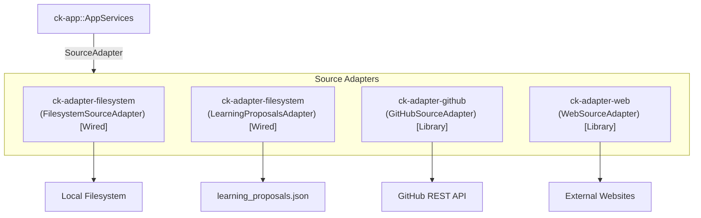

# Subsystem: Source Adapters

The Source Adapters subsystem consists of `ck-adapter-filesystem`, `ck-adapter-github`, and `ck-adapter-web`. It implements data ingestion from external documentation origins into normalized, chunked document records.

---

## 1. Purpose
Context Kernel indexes diverse documentation sources—local disk trees, remote GitHub repositories, and websites. This subsystem discovers raw source files, extracts text content, normalizes formatting, and splits text into structured chunks.

---

## 2. Responsibilities
* Implement the `SourceAdapter` port trait across all supported documentation sources:
  - `FilesystemSourceAdapter`: Recursively scans local file trees for supported extensions (`.md`, `.txt`, `.toml`, `.rs`, `.json`).
  - `LearningProposalsAdapter`: Ingests GodSpeed-Agent learning proposal JSON ledgers.
  - `GitHubSourceAdapter`: Ingests repositories via the GitHub REST API (`git/trees` and `/contents`), detecting response truncation.
  - `WebSourceAdapter`: Fetches web pages with full Server-Side Request Forgery (SSRF) protections, HTML-to-text conversion, and ETag caching.
* Implement `Normalizer` via `MarkdownNormalizer`, extracting clean text, document titles, and metadata.
* Implement `Chunker` via `HeadingChunker`, splitting documents along Markdown headings (`#`, `##`, `###`) and token limits (~800 tokens max).

---

## 3. Non-Responsibilities
* **No Database Storage**: Does not insert documents or chunks into SQLite; yields domain `RawContent` and `Chunk` structs to `AppServices`.
* **No Network Serving**: Does not receive agent requests; acts purely as an ingestion client.

---

## 4. Position in the System
Source adapters are outbound infrastructure adapters called by `ck-app::AppServices` during `ingest_source` and `refresh_source`.

> [!IMPORTANT]
> **Runtime Wiring Reality**:
> * `FilesystemSourceAdapter` and `LearningProposalsAdapter` are wired into the shipped `context-kernal` binary.
> * `GitHubSourceAdapter` and `WebSourceAdapter` are fully implemented and pass all unit tests, but are currently **unwired** in `crates/ck-bin/src/main.rs::wire_app` because `AppServices` takes a single `source_adapter` trait object. Wiring multi-kind adapter dispatch is tracked technical debt in [`.agents/OBSERVED_DEBT.md`](../../.agents/OBSERVED_DEBT.md).

---

## 5. Core Abstractions

### `FilesystemSourceAdapter` ([`crates/ck-adapter-filesystem/src/lib.rs`](../../crates/ck-adapter-filesystem/src/lib.rs))
* Recursively traverses directories, filtering for extensions `md`, `txt`, `toml`, `rs`, and `json`.
* Ignores directory symlinks to avoid directory recursion loops.
* Generates SHA-256 checksums of file contents.

### `HeadingChunker` ([`crates/ck-adapter-filesystem/src/lib.rs`](../../crates/ck-adapter-filesystem/src/lib.rs))
* Partitions documents along Markdown heading lines (`# ...`).
* If a heading section exceeds `MAX_TOKENS_PER_CHUNK` (800 words), it is further split along paragraph boundaries.
* Computes URL-friendly anchor slugs (e.g., `#section-name`).

### `WebSourceAdapter` ([`crates/ck-adapter-web/src/lib.rs`](../../crates/ck-adapter-web/src/lib.rs))
* **SSRF Protection Engine**: Validates URLs against an IP filter before issuing requests:
  - Blocks IPv4 loopback (`127.0.0.0/8`) and unassigned (`0.0.0.0/8`).
  - Blocks private IPv4 RFC 1918 ranges (`10.0.0.0/8`, `172.16.0.0/12`, `192.168.0.0/16`).
  - Blocks link-local (`169.254.0.0/16`).
  - Blocks IPv6 loopback (`::1`), link-local (`fe80::/10`), and unique local (`fc00::/7`).
  - Blocks non-HTTP schemes (`file://`, `ftp://`, `data://`).
  - Resolves hostnames via `DnsResolver`; if resolution yields a private IP or fails, the request fails closed immediately.
* **Conditional Caching**: Uses `If-None-Match` (ETag) and `If-Modified-Since` headers to avoid re-fetching unchanged pages.

### `GitHubSourceAdapter` ([`crates/ck-adapter-github/src/lib.rs`](../../crates/ck-adapter-github/src/lib.rs))
* Queries the GitHub Git Trees API with `recursive=1`.
* Detects the `truncated: true` flag in GitHub's response, immediately returning an error rather than silently indexing a partial repository.
* Decodes base64 file payloads and safely percent-encodes URL path segments.

---

## 6. Internal Operation

### Ingestion Flow
1. `AppServices::ingest_source` calls `SourceAdapter::discover_units`.
2. The adapter returns a vector of `SourceUnit` references (URI, external ID, MIME hint).
3. For each unit, `SourceAdapter::fetch_content` retrieves the raw bytes and revision metadata.
4. `Normalizer::normalize` strips extraneous formatting and identifies titles.
5. `Chunker::chunk` divides the text into `Chunk` records with heading anchors and token counts.
6. The resulting documents and chunks are handed back to `AppServices` for persistence.

---

## 7. State
All source adapters are stateless. Configuration is passed via JSON strings during `discover_units` and `fetch_content`.

---

## 8. Lifecycle
Instantiated once during bootstrap in `main.rs::wire_app`. Invoked on demand during ingestion and refresh.

---

## 9. Failure Modes
* **SSRF Target Attempted**: `WebSourceAdapter` blocks private IP targets with an explicit bail message (`target IP ... is in a blocked private/loopback range`).
* **DNS Resolution Error**: Web adapter treats unresolvable hostnames as fatal for that unit, failing closed.
* **GitHub Rate Limit / Truncation**: GitHub adapter bails with an error if GitHub truncates the tree response or returns an HTTP 403.
* **Unreadable File Permissions**: `FilesystemSourceAdapter` logs the failure and wraps it in an `anyhow::Context` identifying the exact failing path.

---

## 10. Extension Points
* **Adding a New Source Kind**: Implement `SourceAdapter` in a new crate or module.
* **PDF Ingestion Adapter**: Add a PDF text-extraction adapter implementing `SourceAdapter`.
* **Custom Chunker**: Implement `Chunker` for code AST-aware chunking (e.g. tree-sitter chunking).

---

## 11. Source Trail
* `crates/ck-adapter-filesystem/src/lib.rs` — `FilesystemSourceAdapter`, `HeadingChunker` (L130), `MarkdownNormalizer`.
* `crates/ck-adapter-filesystem/src/learning_proposals.rs` — `LearningProposalsAdapter`.
* `crates/ck-adapter-github/src/lib.rs` — `GitHubSourceAdapter`, tree truncation detection (L120).
* `crates/ck-adapter-web/src/lib.rs` — `WebSourceAdapter`, SSRF validation (L160), `is_private_ip` (L50).
