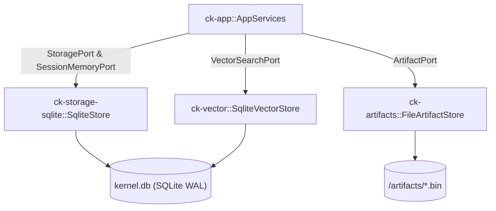

# Subsystem: Storage & Persistence

The Storage & Persistence subsystem consists of `ck-storage-sqlite`, `ck-artifacts`, and `ck-vector`. It provides persistent storage for all relational entities, FTS5 lexical indexes, content-addressed filesystem artifacts, and vector embeddings.

---

## 1. Purpose
This subsystem implements the persistence ports defined in `ck-core`. It manages the local SQLite database file (`kernel.db`) and the on-disk artifact storage directory (`<data_dir>/artifacts/`), providing ACID-compliant local storage and full-text indexing without requiring external database servers.

---

## 2. Responsibilities
* Implement `StoragePort` and `SessionMemoryPort` via `SqliteStore` in `ck-storage-sqlite`.
* Execute embedded database migration SQL (`SCHEMA_V1`) establishing relational tables, virtual FTS5 tables, indexes, and triggers.
* Implement `ArtifactPort` via `FileArtifactStore` in `ck-artifacts`, managing raw payload files on disk with SHA-256 integrity validation and path traversal protection.
* Implement `VectorSearchPort` via `SqliteVectorStore` in `ck-vector`, storing binary float embeddings and calculating brute-force cosine similarities.
* Provide database health checks (`SqliteStore::status`) and full-text index rebuild capabilities (`SqliteStore::rebuild_fts_index`).

---

## 3. Non-Responsibilities
* **No Business Orchestration**: Does not decide when to ingest or recall; executes queries as directed by `AppServices`.
* **No Search Ranking Weighting**: Does not calculate composite hybrid scores; returns raw lexical and vector scores.
* **No HTTP or Remote Transport Handling**: Operates purely on local SQLite connections and filesystem paths.

---

## 4. Position in the System
The storage subsystem sits directly beneath `ck-app`. It implements outbound ports driven by `AppServices`.



---

## 5. Core Abstractions

### `SqliteStore` ([`crates/ck-storage-sqlite/src/lib.rs`](../../crates/ck-storage-sqlite/src/lib.rs))
* Encapsulates access to the SQLite database path.
* Instantiates `rusqlite::Connection` on demand, enabling foreign keys (`PRAGMA foreign_keys = ON`) and WAL mode (`PRAGMA journal_mode = WAL; PRAGMA synchronous = NORMAL;`).
* Provides atomic job coalescing queries and retention sweep queries.

### `FileArtifactStore` ([`crates/ck-artifacts/src/lib.rs`](../../crates/ck-artifacts/src/lib.rs))
* Manages two files per artifact:
  - `<artifact_id>.bin`: Raw binary or UTF-8 text content.
  - `<artifact_id>.meta.json`: Formatted JSON metadata containing size, MIME type, and SHA-256 checksum.
* Path traversal validation:
  ```rust
  fn validate_id(id: &str) -> Result<()> {
      if id.is_empty() { anyhow::bail!("artifact_id must not be empty"); }
      if let Some(bad) = id.chars().find(|c| !c.is_ascii_alphanumeric() && *c != '-' && *c != '_') {
          anyhow::bail!("artifact_id contains invalid character: '{}'", bad);
      }
      Ok(())
  }
  ```

### `SqliteVectorStore` ([`crates/ck-vector/src/lib.rs`](../../crates/ck-vector/src/lib.rs))
* Stores embeddings in SQLite as little-endian IEEE-754 binary float blobs (`encode_vector` / `decode_vector`).
* Performs brute-force cosine similarity across candidate vectors directly in SQLite reader threads.

---

## 6. Internal Operation

### Database Migration & Initialization
When `SqliteStore::migrate()` runs, it executes `SCHEMA_V1`:
1. Enables WAL mode (`PRAGMA journal_mode=WAL; PRAGMA synchronous=NORMAL;`).
2. Creates the `schema_migrations` table and records version 1.
3. Creates relational tables (`sources`, `corpora`, `documents`, `chunks`, `sessions`, `session_events`, `artifacts`, `refresh_jobs`).
4. Creates virtual FTS5 tables (`chunks_fts`, `session_events_fts`, `library_aliases_fts`).
5. Enforces unique active refresh jobs per source via a partial index:
   ```sql
   CREATE UNIQUE INDEX IF NOT EXISTS idx_refresh_jobs_one_active_per_source
     ON refresh_jobs(source_id)
     WHERE status IN ('queued', 'running');
   ```

### Compensation on Artifact Write Failure
When `AppServices::store_context` stores an artifact:
1. The payload is written to `<data_dir>/artifacts/<artifact_id>.bin` and `<artifact_id>.meta.json`.
2. Metadata is inserted into the `artifacts` table in SQLite.
3. If step 2 fails, a compensating cleanup immediately deletes the physical files on disk, preventing orphaned disk leaks.

### Rebuilding the FTS Index
`SqliteStore::rebuild_fts_index()` clears all virtual tables and re-populates them using pure SQL `INSERT ... SELECT` queries directly from the canonical relational tables:
```sql
DELETE FROM chunks_fts;
INSERT INTO chunks_fts (chunk_id, document_id, corpus_id, library_id, title, heading, text)
SELECT c.chunk_id, c.document_id, c.corpus_id, COALESCE(d.library_id, ''),
       COALESCE(d.title, ''), COALESCE(c.heading, ''), c.text
FROM chunks c LEFT JOIN documents d ON c.document_id = d.document_id;
```

---

## 7. State
* **Relational State**: Stored in `kernel.db`. SQLite handles locking and concurrency through WAL mode (multiple readers, one writer).
* **Disk Files**: Stored under `<data_dir>/artifacts/`.
* **In-Memory**: None. Every operation opens a connection or interacts with the filesystem directly.

---

## 8. Lifecycle
1. `SqliteStore::open(path)` creates the parent directory if needed and verifies the path.
2. `SqliteStore::migrate()` ensures tables and FTS virtual tables exist.
3. Operations read and write entities during normal server execution.
4. During startup, if `retention.enabled = true`, retention queries purge expired records and payload files.

---

## 9. Failure Modes
* **Database File Locked**: If another process holds an exclusive write lock, `rusqlite` operations return `SQLITE_BUSY`.
* **Path Traversal Attack**: An attacker attempting to provide an `artifact_id` such as `../../etc/passwd` is blocked by `validate_id`, returning an error.
* **FTS / DB Desynchronization**: If the process crashes mid-ingest between relational inserts and FTS indexing, FTS and relational tables may drift. This is resolved by running `context-kernal rebuild-index`.

---

## 10. Extension Points
* **Alternative Storage Engine**: Implement `StoragePort` and `SessionMemoryPort` for PostgreSQL or RocksDB.
* **Vector Indexing Engine**: Replace brute-force cosine search in `ck-vector` with `sqlite-vec` or HNSW indexes.
* **Cloud Object Store for Artifacts**: Implement `ArtifactPort` backed by AWS S3 or MinIO.

---

## 11. Source Trail
* `crates/ck-storage-sqlite/src/lib.rs` — `SqliteStore`, `SCHEMA_V1` DDL (L1092), FTS rebuild (L74).
* `crates/ck-artifacts/src/lib.rs` — `FileArtifactStore`, `validate_id` (L34), payload storage and deletion.
* `crates/ck-vector/src/lib.rs` — `SqliteVectorStore`, vector encoding/decoding, cosine similarity.
