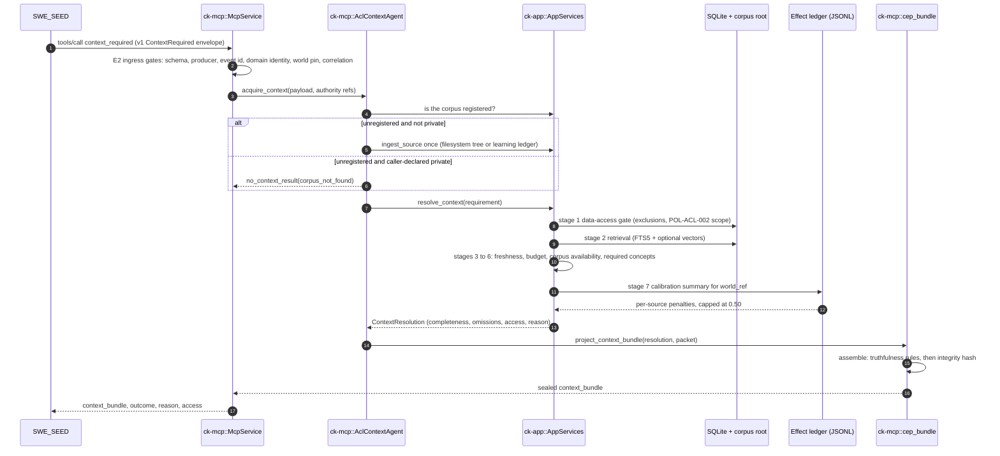

# Workflow: Agentic Capability Loop Integration

This document specifies how Context Kernel integrates into the broader GodSpeed agentic capability loop. It details the frozen E2/E3 convergence boundary, the `context_required` MCP tool, and the non-negotiable contract boundaries shared with SWE_SEED and SEA-Forge.

---

## 1. Summary
In autonomous multi-agent systems, uncoordinated action leads to hallucinated context and unsafe operations. The GodSpeed architecture enforces a strict tripartite separation of concerns:
* **Context Kernel** = Contextual Authority (supplies the grounded working world).
* **SWE_SEED** = Software-Work Orchestration & Proof Authority (routes and proves the work).
* **SEA-Forge** = Runtime Action Authority (governs consequential actions).

Context Kernel implements the `context_required` MCP tool to fulfill the frozen E2/E3 convergence contract: receiving a canonical `ContextRequired` envelope, verifying caller and domain identity fail-closed, and returning a sealed `godspeed.context_bundle` with an explicit completeness status and a machine-readable no-context reason when nothing qualifies. The legacy `ContextPacketCreated` envelope rides along, deprecated, for dual-read migration.

---

## 2. Sequence Diagram

---

## 3. The Frozen Ingress Gates (E2 Boundary)

When `context_required` is invoked over stdio or SSE, `ck-mcp::McpService::handle_context_required` enforces strict fail-closed ingress validation:

1. **Schema Version Check**: `schema_version` must equal `"v1"`.
2. **Event Type Assertion**: `event_type` must equal `"ContextRequired"`.
3. **Authoritative Producer**: `source_agent` must equal `"swe-seed"` or `"swe_seed"`. Context Kernel rejects requests from any other producer.
4. **Causal Lineage**: `event_id` must be non-empty; it becomes the parent `caused_by` ID on the emitted bundle.
5. **Domain Identity Gate (`verify_domain_identity`)**:
   - `domain_model_hash` must be a 64-character lowercase SHA-256 hexadecimal string.
   - Rejects the fallback pseudo-hash (`FALLBACK_PSEUDO_HASH = "dc144cbd71a483431301ca1bf32e95c014af4edba8dbcc525f505310e30a107e"`).
   - Rejects all-zero placeholder digests. Context Kernel never manufactures domain identities.
6. **World Identity Gate (`verify_world_ref`)**:
   - `payload.world_ref` must be `world:<name>@sha256:<64 lowercase hex>`. A missing value, a mutable alias (`world:<name>`) or a label is rejected before any retrieval.
   - Context Kernel checks syntax only. It does not recompute the digest; SEA-Forge and DomainForge own that.
   - The bundle echoes `world_ref` unchanged. `domain_model_hash` stays as legacy identity and is never turned into a `world_ref`.

### Retrieval completeness

The canonical bundle reports `completeness_status` plus `omissions[]`:

* `complete_for_context`: at least one reference and no omissions.
* `partial`: at least one reference and at least one omission.
* `minimal`: no references. The bundle carries the requirement as a question and records the no-context reason as a known omission.

Omission codes are `max_results_reached`, `token_budget_exhausted`, `stale_source_excluded`, and `required_distinction_absent`. The legacy packet path may also emit `citation_content_truncated`. Completeness is relative to the query and corpus, never a claim about reality, and a consumer must not read `partial` as sufficient. A `complete` bundle with an omission, or a `partial` bundle with no references, is refused by the projection.

---

## 4. Acquisition & Zero-Citation Governance (E3 Boundary)

A critical principle of the agentic capability loop is that **missing context must never silently succeed**:

* If references survive resolution:
  - `outcome = "cited"`.
  - Each reference carries `target_uri_or_id`, `availability_status`, `integrity_status`, and any `limitations`.
* If zero references survive:
  - If the acquisition was optional (`required = false`), `outcome = "empty_optional"`.
  - If required, `outcome = "no_context_governed"` with a machine-readable `reason`, and the bundle becomes `minimal`:
    * `corpus_root_unconfigured`: the corpus root is unset, so nothing can be ingested.
    * `corpus_not_found`: the requested corpus is absent, or a caller-declared private corpus is not registered.
    * `corpus_unavailable`: ingest failed at the adapter.
    * `corpus_scope_unresolved`: a private corpus needs a scope claim, or the claim excludes it.
    * `corpus_excluded`: policy excludes the corpus from this retrieval.
    * `budget_exhausted`: the token ceiling admitted no result.
    * `no_fresh_content`: every candidate exceeded the freshness window.
    * `no_matching_content`: retrieval found nothing for the query.

`access` is reported alongside the outcome: `accessible`, `inaccessible` (with `excluded` or `out_of_scope`), or `requires_scope`. It describes context access only. For the full stage-by-stage walkthrough, see [Context Requirement Resolution](context-requirement-resolution.md) and the interactive [Context Requirement Explorer](../explainers/context-requirement-explorer.html).

---

## 5. Authority Pass-Through Contract

> [!IMPORTANT]
> **Context Kernel Never Decides Action Authority**:
> In earlier prototypes, Context Kernel generated a `ContextAuthorized` decision (`POL-ACL-002`). This breached architectural boundaries. Under the frozen contract:
> * **SEA-Forge** is the sole authority for runtime actions.
> * Context Kernel includes authority *references* (linking cited context to a prior verified SEA allow), but **never creates authority decisions**.

---

## 6. Configuration Environment

The ACL context agent is activated via environment variables:
* `CK_CONTEXT_CORPUS_ROOT`: Path to the filesystem corpus root directory.
* `CK_LEARNING_PROPOSALS_LEDGER`: Path to the GodSpeed learning proposals ledger JSON file.
* `CK_CONTEXT_EFFECT_LEDGER`: Path to the per-world JSONL effect ledger. When unset, retrieval is uncalibrated and `ingest_context_effects` reports the ledger as unavailable.

If no corpus variable is set, the `context_required` tool reports itself as unconfigured rather than causing the Context Kernel server to fail startup.

---

## 7. Source Trail
* `crates/ck-mcp/src/lib.rs` — `handle_context_required` (L476), `handle_ingest_context_effects` (L441).
* `crates/ck-mcp/src/agentic_capability_loop.rs` — `verify_domain_identity` (L51), `verify_world_ref` (L91), `acquire_context` (L288), `ensure_corpus_ingested` (L420).
* `crates/ck-app/src/context.rs` — `ContextRequirement` (L69), `ContextAccess` (L120), `resolve_context` (L245), `ingest_context_effects` (L579).
* `crates/ck-mcp/src/cep_bundle.rs` — `canonical_json` (L70), `assemble` (L179), `project_context_bundle` (L345).
* `docs/agentic_loop_boundaries.md` — Canonical boundary specification for the GodSpeed ecosystem.
