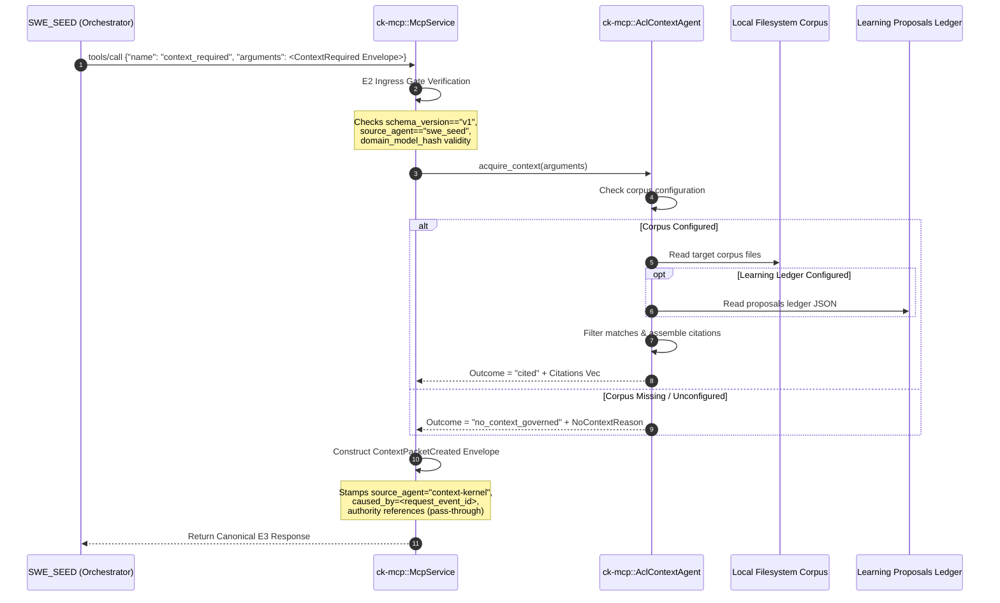

# Workflow: Agentic Capability Loop Integration

This document specifies how Context Kernel integrates into the broader GodSpeed agentic capability loop. It details the frozen E2/E3 convergence boundary, the `context_required` MCP tool, and the non-negotiable contract boundaries shared with SWE_SEED and SEA-Forge.

---

## 1. Summary
In autonomous multi-agent systems, uncoordinated action leads to hallucinated context and unsafe operations. The GodSpeed architecture enforces a strict tripartite separation of concerns:
* **Context Kernel** = Contextual Authority (supplies the grounded working world).
* **SWE_SEED** = Software-Work Orchestration & Proof Authority (routes and proves the work).
* **SEA-Forge** = Runtime Action Authority (governs consequential actions).

Context Kernel implements the `context_required` MCP tool to fulfill the frozen E2/E3 convergence contract: receiving a canonical `ContextRequired` envelope, verifying caller and domain identity fail-closed, and returning a citation-bearing `ContextPacketCreated` envelope.

---

## 2. Sequence Diagram

---

## 3. The Frozen Ingress Gates (E2 Boundary)

When `context_required` is invoked over stdio or SSE, `ck-mcp::McpService::handle_context_required` enforces strict fail-closed ingress validation:

1. **Schema Version Check**: `schema_version` must equal `"v1"`.
2. **Event Type Assertion**: `event_type` must equal `"ContextRequired"`.
3. **Authoritative Producer**: `source_agent` must equal `"swe-seed"` or `"swe_seed"`. Context Kernel rejects requests from any other producer.
4. **Causal Lineage**: `event_id` must be non-empty; it becomes the parent `caused_by` ID on the emitted packet.
5. **Domain Identity Gate (`verify_domain_identity`)**:
   - `domain_model_hash` must be a 64-character lowercase SHA-256 hexadecimal string.
   - Rejects the fallback pseudo-hash (`FALLBACK_PSEUDO_HASH = "dc144cbd71a483431301ca1bf32e95c014af4edba8dbcc525f505310e30a107e"`).
   - Rejects all-zero placeholder digests. Context Kernel never manufactures domain identities.
6. **World Identity Gate (`verify_world_ref`)**:
   - `payload.world_ref` must be `world:<name>@sha256:<64 lowercase hex>`. A missing value, a mutable alias (`world:<name>`) or a label is rejected before any retrieval.
   - Context Kernel checks syntax only. It does not recompute the digest; SEA-Forge and DomainForge own that.
   - The packet echoes `world_ref` unchanged. `domain_model_hash` stays as legacy identity and is never turned into a `world_ref`.

### Retrieval completeness

Every packet carries `retrieval_completeness` (`complete`, `partial`, `none`) and `omissions[]`. `complete` means every unit matching the query in the corpus was returned in full. Reaching `max_results` with a further match (`max_results_reached`) or cutting a citation to its first 500 characters (`citation_content_truncated`, also flagged per citation as `truncated`) makes the packet `partial`. Zero citations is `none`. Completeness is relative to the query and corpus, never a claim about reality, and a consumer must not read `partial` as sufficient.

---

## 4. Acquisition & Zero-Citation Governance (E3 Boundary)

A critical principle of the agentic capability loop is that **missing context must never silently succeed**:

* If matching documents or proposals are found:
  - Emits `outcome = "cited"`.
  - Attaches structured citation records containing `uri`, `heading`, and `excerpt`.
* If zero citations are found:
  - If the corpus was not required (`required = false`), returns `outcome = "no_context"`.
  - If the corpus was required (`required = true`), returns `outcome = "no_context_governed"` with a machine-readable reason:
    * `corpus_root_unconfigured`: The root environment path was not set.
    * `corpus_not_found`: The requested corpus subdirectory does not exist under the root.
    * `no_matching_content`: The corpus directory exists but no text matched the query.

---

## 5. Authority Pass-Through Contract

> [!IMPORTANT]
> **Context Kernel Never Decides Action Authority**:
> In earlier prototypes, Context Kernel generated a `ContextAuthorized` decision (`POL-ACL-002`). This breached architectural boundaries. Under the frozen contract:
> * **SEA-Forge** is the sole authority for runtime actions.
> * Context Kernel includes authority *references* (linking cited context to a prior verified SEA allow), but **never creates authority decisions**.

---

## 6. Configuration Environment

The ACL context agent is activated via environment variables:
* `CK_CONTEXT_CORPUS_ROOT`: Path to the filesystem corpus root directory.
* `CK_LEARNING_PROPOSALS_LEDGER`: Path to the GodSpeed learning proposals ledger JSON file.

If neither environment variable is set, the `context_required` tool reports itself as unconfigured rather than causing the Context Kernel server to fail startup.

---

## 7. Source Trail
* `crates/ck-mcp/src/lib.rs` — `handle_context_required` (L449).
* `crates/ck-mcp/src/agentic_capability_loop.rs` — `verify_domain_identity` (L51), `NoContextReason` (L71), `AclContextAgent`.
* `docs/agentic_loop_boundaries.md` — Canonical boundary specification for the GodSpeed ecosystem.
