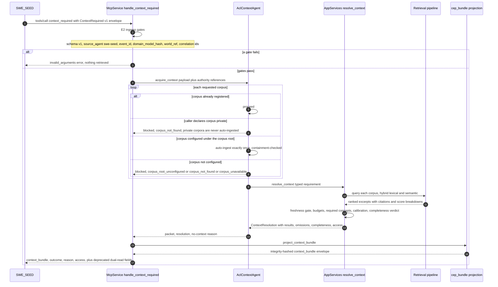
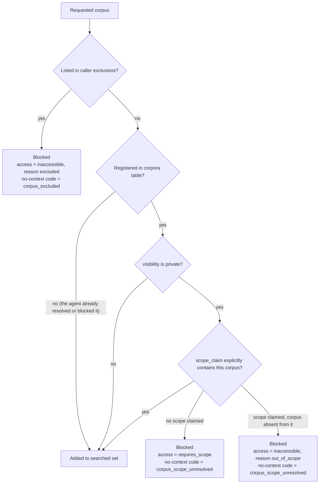
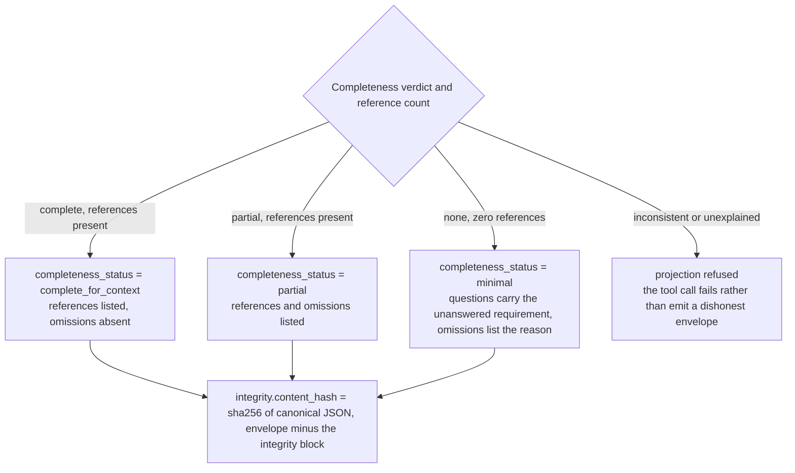
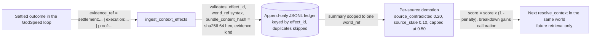

# Workflow: Context Requirement Resolution

This page traces what happens inside Context Kernel when SWE_SEED calls the `context_required` MCP tool. It follows one typed context demand through the ingress gates, the data-access decision, the real retrieval pipeline, budget and freshness accounting, the completeness verdict, and the CEP `godspeed.context_bundle` projection.

For the boundary contract with SWE_SEED and SEA-Forge, read [agentic-capability-loop.md](agentic-capability-loop.md) first. For the wire shapes, read [mcp-contracts.md](../mcp-contracts.md) and [reference/mcp-tools.md](../reference/mcp-tools.md). To manipulate the pipeline yourself, open the interactive [Context Requirement Explorer](../explainers/context-requirement-explorer.html).

---

## 1. Summary

The caller states a bounded demand: *which corpora, which query, which constraints, which budget, pinned to which world revision*. Context Kernel answers three questions in order:

1. **Is the requested context accessible to this caller?** (`access`: `accessible`, `inaccessible`, or `requires_scope`)
2. **How much of the matching context was actually supplied?** (`completeness`: `complete`, `partial`, or `none`)
3. **What was left out, and why?** (machine-readable `omissions` codes)

The answer is returned bundle-first: the canonical CEP-0008 `godspeed.context_bundle` envelope, then `outcome`, `reason`, and `access`. The legacy `context_envelope` and `context_packet` fields remain on the wire for dual-read compatibility and are deprecated.

Absence is never fabricated into context. A blocked or empty retrieval returns `completeness = none` with a machine-readable reason, and a partial retrieval always names its omissions.

---

## 2. End-to-End Sequence

What to notice: the context agent never runs its own retrieval. It resolves requested corpora into the kernel and delegates everything to `AppServices::resolve_context`, the same pipeline `query_reference` uses. There is no second, degraded integration path (decision recorded 2026-10-07, `.agents/decisions.md`).

---

## 3. The Data-Access Gate Runs Before Any Retrieval

Access is decided per requested corpus before a single chunk is searched ([`crates/ck-app/src/context.rs` L253-296](../../crates/ck-app/src/context.rs)). Storage is authoritative: the `corpora.visibility` column decides, not the caller's `is_private` claim.

What to notice: an empty `scope_claim` and a wrong `scope_claim` produce different `access` results. `requires_scope` is an explicit unresolved condition, never a silent grant or denial. A caller-declared-private unregistered corpus is never auto-ingested; it resolves to `corpus_not_found` ([`crates/ck-mcp/src/agentic_capability_loop.rs` L303-316](../../crates/ck-mcp/src/agentic_capability_loop.rs)).

The same rule guards direct queries: `query_reference` against a private corpus fails unless `filters.source_scope` explicitly contains it ([`crates/ck-app/src/lib.rs` L604-633](../../crates/ck-app/src/lib.rs)).

---

## 4. Resolution Stages

`AppServices::resolve_context` ([`crates/ck-app/src/context.rs` L245-535](../../crates/ck-app/src/context.rs)) runs eight stages in a fixed order. Every stage either narrows the result set or records a machine-readable omission.

| Stage | What happens | Omission it can record |
| :--- | :--- | :--- |
| 1. Data-access gate | Checks exclusions and private-corpus scope per corpus. A blocked corpus ends resolution immediately with a no-context reason. | `corpus_excluded`, `corpus_scope_unresolved` |
| 2. Real retrieval | Runs `query_reference` per requested corpus (whole kernel scope when none requested), default mode `hybrid`, merging and re-sorting candidates by score. | none |
| 3. Freshness gate | When `freshness_max_age_secs` is declared, drops results whose source is older. A result with no attributable source timestamp is never treated as stale. | `stale_source_excluded` |
| 4. Budget application | Keeps results up to `max_results` (further narrowed by `budget.max_chunks`), then up to `max_tokens`. Token cost is the whitespace word count of excerpt plus title. | `token_budget_exhausted`, `max_results_reached` |
| 5. Corpus availability | Every requested corpus that is not registered gets a per-corpus omission. | `corpus_not_found` with the corpus id as detail |
| 6. Required concepts | Each declared `required_concepts` entry must appear in a kept result's title, heading, excerpt, or citation. Zero kept results produce a no-context outcome instead. | `required_distinction_absent` with the concept as detail |
| 7. Prospective calibration | Applies the per-world settlement-backed penalty to each result's source, multiplies `score` by `1 - penalty`, and re-sorts. | none |
| 8. Completeness verdict | At the resolution layer: empty omission list means `complete`, otherwise `partial`. Projection maps these to `complete_for_context` and `partial`, and a zero-reference resolution to `minimal`. | none |

When stage 6 finds the kept set empty, resolution stops with `completeness = none` and one reason code, chosen by precedence ([`crates/ck-app/src/context.rs` L407-424](../../crates/ck-app/src/context.rs)):

1. `budget_exhausted`: the token budget could not cover even one result.
2. `no_fresh_content`: candidates existed but every one violated the declared freshness window.
3. `corpus_not_found`: a requested corpus is not registered.
4. `no_matching_content`: everything else, the corpus exists but nothing matched.

The full no-context vocabulary, with the wire string for each:

| `NoContextReason` | Wire string | Where it arises |
| :--- | :--- | :--- |
| `CorpusRootUnconfigured` | `corpus_root_unconfigured` | Corpus root or learning-proposals ledger not configured |
| `CorpusNotFound` | `corpus_not_found` | Corpus not registered and not discoverable; also the refusal for caller-declared-private unregistered corpora |
| `CorpusUnavailable` | `corpus_unavailable` | Auto-ingest of a configured corpus failed |
| `NoMatchingContent` | `no_matching_content` | Retrieval ran, nothing matched |
| `ScopeUnresolved` | `corpus_scope_unresolved` | Private corpus without an explicit, matching scope claim |
| `CorpusExcluded` | `corpus_excluded` | Caller's own exclusions barred the corpus |
| `BudgetExhausted` | `budget_exhausted` | Token budget too small for one result |
| `StaleContent` | `no_fresh_content` | Every candidate was older than the declared freshness window |

---

## 5. The Response Triple and the Bundle

The tool response carries three top-level facts plus the bundle:

* `outcome`: `cited` (at least one citation), `no_context_governed` (required context, zero citations), or `empty_optional` (optional acquisition, zero citations).
* `reason`: the no-context wire string, or `null` when context was supplied.
* `access`: `{"result": "accessible"}`, `{"result": "inaccessible", "corpus_id": ..., "reason": "excluded" | "out_of_scope"}`, or `{"result": "requires_scope", "corpus_id": ...}`.

The projection onto the CEP profile refuses to state anything the resolution does not support ([`crates/ck-mcp/src/cep_bundle.rs` L179-331](../../crates/ck-mcp/src/cep_bundle.rs)):

What to notice: a `none` bundle never carries `references`; it carries `questions` with the unanswered `context_requirement_id`. A `complete` bundle never carries `omissions`. A partial or empty retrieval that cannot name a single omission or reason is refused outright (`BundleError::UnexplainedIncompleteness`), which surfaces as an MCP internal error rather than a dishonest envelope.

The `integrity.content_hash` is the SHA-256 of the canonical JSON of the envelope with the `integrity` block removed: recursively sorted keys, compact separators, UTF-8 unescaped, every float rounded to 6 decimals and negative zero flattened. Float normalization is mandatory; JSON parsers are permitted 1-ULP drift, and hashing raw floats would make the same envelope hash differently after a parse round-trip. `envelope_id` (occurrence), `content_hash` (exact content), and `scope.world_ref` (semantic world) are three deliberately separate identities.

---

## 6. Settlement-Backed Calibration

The `ingest_context_effects` tool is the only durable calibration path. It records how supplied context performed, but only when a settlement or evidence artifact from the GodSpeed loop backs the claim. An agent's self-report is never evidence.

What to notice: the ledger is append-only and per-world. Calibration never crosses worlds, and historical bundles are never rewritten; effects influence future retrieval only. If the ledger is configured but unreadable at resolution time, the pipeline logs a warning and proceeds uncalibrated rather than failing the request ([`crates/ck-app/src/context.rs` L500-506](../../crates/ck-app/src/context.rs)).

---

## 7. Configuration

The context path is env-gated and fails explicit, never silent ([`crates/ck-bin/src/main.rs` L435-458](../../crates/ck-bin/src/main.rs)):

| Variable | Enables | Absence means |
| :--- | :--- | :--- |
| `CK_CONTEXT_CORPUS_ROOT` | Filesystem-corpus auto-ingest under the root | `context_required` reports itself unconfigured |
| `CK_LEARNING_PROPOSALS_LEDGER` | The learning-proposals corpus via `LearningProposalsAdapter` | `learning-proposals*` corpora block with `corpus_root_unconfigured` |
| `CK_CONTEXT_EFFECT_LEDGER` | The context-effect JSONL ledger | Calibration disabled, never faked |

A `corpus_id` that escapes the configured corpus root via path traversal is a hard refusal, not a quiet no-context ([`crates/ck-mcp/src/agentic_capability_loop.rs` L458-463](../../crates/ck-mcp/src/agentic_capability_loop.rs)).

---

## 8. Source Trail

* `crates/ck-mcp/src/lib.rs` — `handle_context_required` (L476), E2 ingress gates, response assembly (L562-569), `handle_ingest_context_effects` (L441).
* `crates/ck-mcp/src/agentic_capability_loop.rs` — `ContextRequiredPayload::to_requirement` (L144), `AclContextAgent::acquire_context` (L288), `ensure_corpus_ingested` (L420).
* `crates/ck-app/src/context.rs` — `ContextRequirement` (L69), `ContextAccess` (L120), `resolve_context` (L245), `result_is_stale` (L540).
* `crates/ck-app/src/context_effect.rs` — `ContextEffect`, `ContextEffectStore`, `CalibrationSummary`.
* `crates/ck-mcp/src/cep_bundle.rs` — `project_context_bundle` (L345), `assemble` (L179), `canonical_json` (L70), `validate_context_bundle` (L515).
* `crates/ck-core/src/types/context.rs` — `RetrievalCompleteness`, `NoContextReason`, `verify_world_ref` (L91), omission code constants (L173-179).
* Tests: `crates/ck-mcp/tests/context_pipeline.rs`, `context_bundle_conformance.rs`, `context_calibration.rs`, `acl_context_agent.rs`, `e2e_world_loop.rs`.
