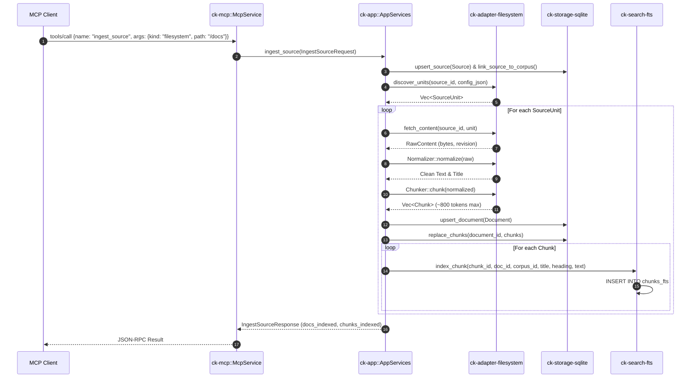

# Workflow: Documentation Ingestion & Refresh

This document details the end-to-end execution path for ingesting and refreshing documentation sources in Context Kernel. It covers unit discovery, content extraction, Markdown normalization, heading-based chunking, SQLite persistence, and FTS5 index updates.

---

## 1. Summary
Documentation ingestion converts raw documentation origins (e.g. local directory trees) into searchable text chunks in SQLite and FTS5. Ingestion creates new source records and documents. Refreshing re-scans an existing source and atomically replaces prior documents and chunks without accumulating stale duplicate records.

---

## 2. Sequence Diagram

---

## 3. Detailed Execution Path

### Step 1: Request Ingress & Entity Creation
* **Code Symbol**: `AppServices::ingest_source` in [`crates/ck-app/src/lib.rs`](file:///crates/ck-app/src/lib.rs#L348).
* Creates or verifies the `Corpus`.
* Generates a `Source` struct with kind (`filesystem`), config JSON, and freshness TTL.
* Links source to corpus via `StoragePort::link_source_to_corpus`.

### Step 2: Unit Discovery
* **Code Symbol**: `SourceAdapter::discover_units` in [`crates/ck-adapter-filesystem/src/lib.rs`](file:///crates/ck-adapter-filesystem/src/lib.rs#L104).
* Recursively walks the specified root directory.
* Filters for files matching supported extensions: `.md`, `.txt`, `.toml`, `.rs`, `.json`.
* Returns a list of `SourceUnit` references containing relative URIs.

### Step 3: Content Fetching & Normalization
* **Code Symbol**: `SourceAdapter::fetch_content` and `MarkdownNormalizer::normalize`.
* Reads the file content into memory and computes a SHA-256 checksum.
* Extracts the document title from the first Markdown `# Heading` or falls back to the file stem.

### Step 4: Heading-Based Chunking
* **Code Symbol**: `HeadingChunker::chunk` in [`crates/ck-adapter-filesystem/src/lib.rs`](file:///crates/ck-adapter-filesystem/src/lib.rs#L133).
* Splits text along heading lines (`#`, `##`, `###`).
* If a section exceeds 800 words (`MAX_TOKENS_PER_CHUNK`), splits across paragraph boundaries.
* Generates URL-friendly anchor slugs (e.g., `#installing-the-cli`).
* Returns a slice of `Chunk` entities with sequential ordinals.

### Step 5: Database & FTS5 Indexing
* **Code Symbol**: `StoragePort::upsert_document`, `replace_chunks`, and `LexicalSearchPort::index_chunk`.
* Inserts the `Document` and `Chunk` records into SQLite with foreign key relationships.
* Inserts each chunk into the SQLite virtual table `chunks_fts` with columns:
  `chunk_id`, `document_id`, `corpus_id`, `library_id`, `title`, `heading`, `text`.

### Step 6: Refresh Workflow & Non-Accumulation
* **Code Symbol**: `AppServices::refresh_source` in [`crates/ck-app/src/lib.rs`](file:///crates/ck-app/src/lib.rs#L1881).
* When a source is refreshed:
  1. Lists existing documents for the source: `StoragePort::list_documents_by_source`.
  2. For every prior document, removes its indexed chunks from FTS5:
     `LexicalSearchPort::remove_chunks_by_document(document_id)`.
  3. Deletes prior documents from SQLite (foreign key `ON DELETE CASCADE` purges old canonical chunks).
  4. Runs discovery, fetching, chunking, and indexing as in Steps 2–5.
  5. Updates `last_refresh_success_at` and resets `last_refresh_error = None`.

---

## 4. State Changes
* **SQLite `sources`**: Inserted or updated with latest refresh timestamps.
* **SQLite `documents` & `chunks`**: Existing rows replaced; new rows inserted.
* **SQLite `chunks_fts`**: Virtual table entries added; old entries purged.

---

## 5. Failure Branches
* **Directory Unreadable**: If `discover_units` fails due to permissions or missing paths, `AppServices` returns an error and sets `SourceHealth::Degraded`.
* **Single File Read Failure**: If fetching one file fails, `AppServices::ingest_source` propagates the error and aborts the ingestion; it does not continue with the remaining files. The snapshot is prepared before any existing rows are replaced, so the prior snapshot is preserved.
* **FTS Insert Failure**: If an FTS write fails, an error is logged. Index consistency can be restored via `rebuild-index`.

---

## 6. Source Trail
* `crates/ck-app/src/lib.rs` — `ingest_source` (L348), `refresh_source` (L1881).
* `crates/ck-adapter-filesystem/src/lib.rs` — `FilesystemSourceAdapter`, `HeadingChunker` (L133).
* `crates/ck-search-fts/src/lib.rs` — `index_chunk` (L65), `remove_chunks_by_document` (L86).
