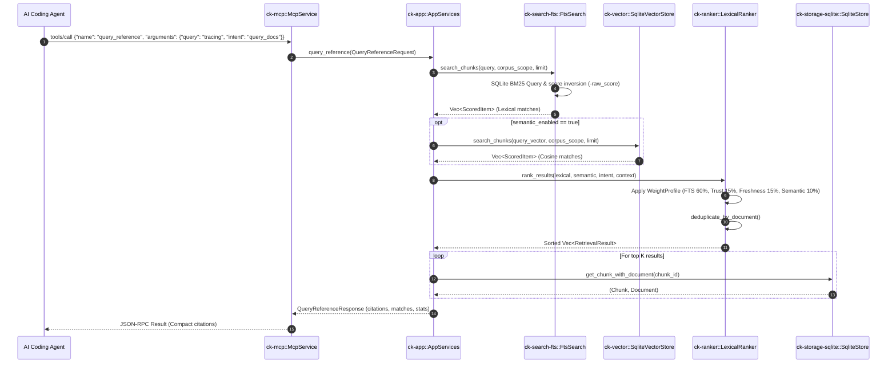

# Workflow: Reference Query & Resolution

This document details the execution trace for searching documentation chunks (`query_reference`), resolving library identifiers (`resolve_reference`), and generating token-efficient citations.

---

## 1. Summary
When an agent needs API documentation or codebase references, it calls `query_reference` or `resolve_reference`. Context Kernel performs lexical FTS5 BM25 search (plus optional vector similarity), applies an intent-weighted scoring formula, de-duplicates results by document, and returns compact excerpts with line and heading anchors.

---

## 2. Sequence Diagram



---

## 3. Detailed Execution Path

### Step 1: Request Ingress & Intent Analysis
* **Code Symbol**: `AppServices::query_reference` in [`crates/ck-app/src/lib.rs`](file:///crates/ck-app/src/lib.rs#L536).
* Analyzes `intent` string, mapping to `QueryIntent::QueryDocs`, `SearchRefs`, `ResolveLibrary`, or `General`.
* Resolves the target corpus list from `source_scope`. If omitted, defaults to all accessible corpora.

### Step 2: Lexical FTS5 Search
* **Code Symbol**: `FtsSearch::search_chunks` in [`crates/ck-search-fts/src/lib.rs`](file:///crates/ck-search-fts/src/lib.rs#L104).
* The query is sanitized by `fts_query`: individual tokens are quoted with double-quotes, internal quotes are escaped, and tokens are joined with `OR`.
* Executes SQL against `chunks_fts`:
  ```sql
  SELECT chunk_id, bm25(chunks_fts, 5.0, 3.0, 1.0) AS score
  FROM chunks_fts
  WHERE chunks_fts MATCH ? AND corpus_id IN (...)
  ORDER BY score ASC LIMIT ?
  ```
  *(Note: Weights `5.0, 3.0, 1.0` correspond to `title`, `heading`, and `text` columns).*
* Inverts the score: `score = -raw_score` so that higher values represent better matches.

### Step 3: Optional Vector Search
* If semantic search is enabled, queries `OpenAIEmbeddingProvider::embed` for an embedding vector, then calls `SqliteVectorStore::search_chunks` for brute-force cosine similarity matches.

### Step 4: Hybrid Ranking & De-duplication
* **Code Symbol**: `LexicalRanker::rank_results` in [`crates/ck-ranker/src/lib.rs`](file:///crates/ck-ranker/src/lib.rs#L173).
* Retrieves the `WeightProfile` for the query intent.
* Computes composite score for each chunk:
  $$\text{Score} = w_{\text{fts}} \cdot S_{\text{fts}} + w_{\text{trust}} \cdot S_{\text{trust}} + w_{\text{freshness}} \cdot S_{\text{freshness}} + w_{\text{sem}} \cdot S_{\text{sem}}$$
* Groups chunks by `document_id` via `deduplicate_by_document`, ensuring that only the single highest-scoring chunk from any document appears in the primary results.

### Step 5: Citation & Excerpt Generation
* **Code Symbol**: `StoragePort::get_chunk_with_document`.
* Retrieves the chunk text, section heading, document URI, and library version.
* Builds structured citation objects:
  ```json
  {
    "document_id": "doc_01...",
    "chunk_id": "chk_01...",
    "uri": "crates/ck-core/src/lib.rs",
    "heading": "Ports",
    "excerpt": "... bounded text chunk ...",
    "score": 0.842
  }
  ```

---

## 4. Library Resolution (`resolve_reference`)

When an agent calls `resolve_reference` (or compatibility alias `resolve-library-id`):
1. Looks up exact alias matches in the `library_aliases` table.
2. If no exact match is found, queries `library_aliases_fts` using BM25 full-text matching.
3. Ranks candidate libraries using the `ResolveLibrary` intent profile (giving 30% weight to library `trust_score`).
4. Returns canonical library identifiers (`provider`, `name`, `version`, `summary`).

---

## 5. State Changes
This workflow is strictly **read-only**. It reads from SQLite tables and virtual tables, modifying zero database or filesystem state.

---

## 6. Failure Branches
* **Malformed Query String**: Stripped and sanitized by `fts_query`; if query contains only punctuation, returns an empty result set rather than a syntax error.
* **Corpus Unauthorized**: `ck-auth` blocks access to unauthorized corpora before retrieval begins, returning `McpError::InvalidArguments`.
* **Zero Results**: Returns an empty array in `candidates` or `matches` with total hits reported as 0.

---

## 7. Source Trail
* `crates/ck-app/src/lib.rs` — `query_reference` (L536), `resolve_reference` (L1785).
* `crates/ck-search-fts/src/lib.rs` — `search_chunks` (L104), `fts_query` (L24).
* `crates/ck-ranker/src/lib.rs` — `WeightProfile::for_intent` (L18), `rank_results` (L173).
