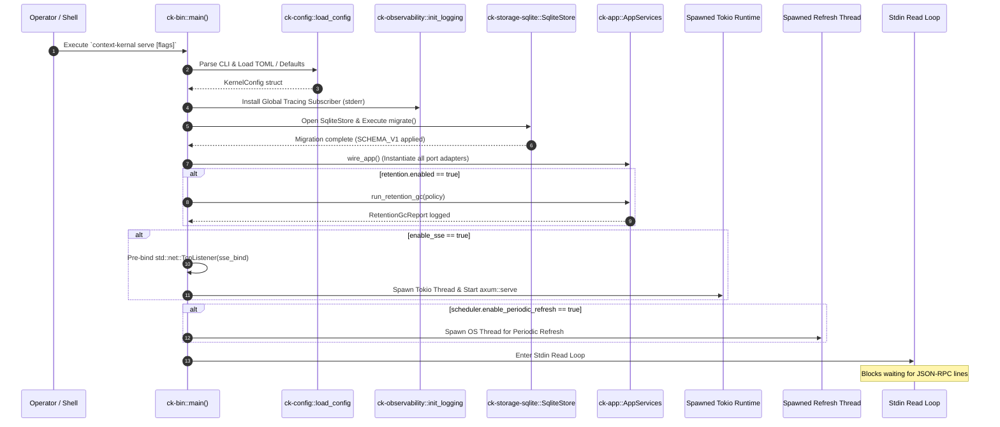

# Workflow: Service Lifecycle & Startup

This document traces the complete execution lifecycle of the `context-kernal` binary, from argument parsing and configuration resolution through database migration, adapter wiring, worker thread spawning, hot configuration reload, and shutdown.

---

## 1. Summary
Context Kernel initializes as a single operating system process. It loads configuration (falling back to built-in defaults), initializes structured tracing, runs database migrations, instantiates ports-and-adapters, executes startup retention GC, pre-binds network listeners, spawns auxiliary worker threads (Tokio SSE server and periodic source refresher), and serves JSON-RPC MCP requests over standard input.

---

## 2. Sequence Diagram

---

## 3. Detailed Execution Path

### Step 1: Argument Parsing & Configuration
* **Code Symbol**: `Cli::parse()` and `open_store()` in [`crates/ck-bin/src/main.rs`](../../crates/ck-bin/src/main.rs#L51-L67).
* If `--config <path>` is passed, `ck_config::load_config(path)` parses the TOML file and expands environment variables (`${VAR}`).
* If `--database <path>` is passed, it overrides `config.storage.database_path`.
* If no config file is supplied, `ck_config::default_config()` supplies defaults.

### Step 2: Global Tracing Installation
* **Code Symbol**: `init_logging(&config)` in [`crates/ck-bin/src/main.rs`](../../crates/ck-bin/src/main.rs#L345).
* Sets a global subscriber via `tracing::subscriber::set_global_default`.
* Emits text formatting or JSON formatting (`config.observability.log_format == "json"`) directly to `std::io::stderr`.

### Step 3: Migration Execution
* **Code Symbol**: `store.migrate()` in [`crates/ck-storage-sqlite/src/lib.rs`](../../crates/ck-storage-sqlite/src/lib.rs#L44).
* Opens a SQLite connection with `PRAGMA foreign_keys = ON;` and runs the idempotent SQL script `SCHEMA_V1`.

### Step 4: Adapter Composition (`wire_app`)
* **Code Symbol**: `wire_app()` in [`crates/ck-bin/src/main.rs`](../../crates/ck-bin/src/main.rs#L367).
* Instantiates:
  - `SqliteStore` (implements `StoragePort` and `SessionMemoryPort`)
  - `FileArtifactStore` pointing to `data_dir/artifacts` (implements `ArtifactPort`)
  - `FtsSearch` (implements `LexicalSearchPort`)
  - `LexicalRanker` (implements `RankerPort`)
  - `FilesystemSourceAdapter` (implements `SourceAdapter`)
  - `MarkdownNormalizer` and `HeadingChunker`
  - Optional `OpenAIEmbeddingProvider` and `SqliteVectorStore`

### Step 5: Startup Retention GC Sweep
* **Code Symbol**: `app.run_retention_gc()` in [`crates/ck-app/src/lib.rs`](../../crates/ck-app/src/lib.rs#L50).
* Calculates cutoff timestamps for events, sessions, jobs, artifacts, and disabled sources.
* Deletes expired database rows and cleans up artifact `.bin` and `.meta.json` payload files.

### Step 6: SSE Listener Pre-Binding & Thread Spawn
* **Code Symbol**: `std::net::TcpListener::bind(sse_bind)` in [`crates/ck-bin/src/main.rs`](../../crates/ck-bin/src/main.rs#L146).
* The socket is bound **on the main thread** and set non-blocking before spawning. If the port is already bound, startup immediately aborts with an error.
* Moves the listener into a background thread running a dedicated Tokio multi-threaded runtime executing `axum::serve`.

### Step 7: Background Periodic Refresh Thread
* **Code Symbol**: `std::thread::spawn` in [`crates/ck-bin/src/main.rs`](../../crates/ck-bin/src/main.rs#L190).
* Loops every `scheduler.refresh_interval_secs`, checks for stale sources via `StoragePort::list_stale_sources`, and invokes `AppServices::refresh_source`.

### Step 8: Stdio Serving & Hot Reload
* **Code Symbol**: `for line in io::stdin().lock().lines()` in [`crates/ck-bin/src/main.rs`](../../crates/ck-bin/src/main.rs#L243).
* If `reload.enabled = true`, checks the config file for on-disk changes. If modified, rebuilds `AppServices` and atomically swaps the state in `ReloadableSseState`.
* Passes each line to `ck_transport_stdio::handle_line` and prints the JSON-RPC response to stdout.

---

## 4. State Changes
* **Filesystem**: Creates the database directory and artifact directory if missing.
* **SQLite**: Applies `SCHEMA_V1` tables and triggers if not already present.
* **Memory**: Allocates `AppServices`, `McpService`, and `ReloadableSseState`.

---

## 5. Failure Branches
1. **Invalid TOML / Missing Config**: `load_config` returns an error, process exits with status 1.
2. **Database Locked / Inaccessible**: `store.migrate()` fails, process exits with status 1.
3. **Port Conflict**: `TcpListener::bind` fails, process terminates with error `failed to bind SSE listener on ...`.
4. **Auth Required But No Tokens**: If `require_auth = true` and `tokens` is empty, process fails startup with `SSE auth is required but no auth tokens are configured`.

---

## 6. Source Trail
* `crates/ck-bin/src/main.rs` — `main()` (L51), `serve()` (L65), `wire_app()` (L367), `init_logging()` (L345).
* `crates/ck-storage-sqlite/src/lib.rs` — `SqliteStore::open()`, `migrate()` (L44).
* `crates/ck-transport-sse/src/lib.rs` — `serve_sse()` (L45), `ReloadableSseState` (L15).
