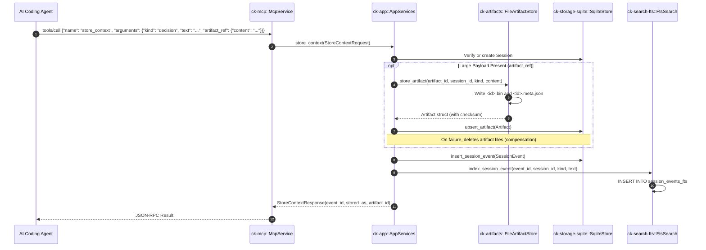

# Workflow: Session Context Continuity & Retention

This document traces how session events are stored (`store_context`), how large payloads are offloaded to content-addressed artifact files, how prior decisions are recalled (`recall_context`), and how retention garbage collection prunes expired state while guaranteeing pinned event persistence.

---

## 1. Summary
AI coding agents often lose track of architectural decisions across conversation compaction or multi-agent handoffs. Context Kernel provides a durable session timeline backed by SQLite and an on-disk artifact store. Events are classified as permanent, pinnable, or ephemeral. Startup retention sweeps purge stale records while preserving pinned events.

---

## 2. Sequence Diagram



---

## 3. Detailed Execution Path

### Context Storage (`store_context`)
* **Code Symbol**: `AppServices::store_context` in [`crates/ck-app/src/lib.rs`](../../crates/ck-app/src/lib.rs#L158).
1. Resolves `session_id` (defaults to `"default"` if unspecified). If the session does not exist, auto-creates it in SQLite with `status = "active"`.
2. Checks for `artifact_ref`:
   - If present, decodes base64 bytes (or falls back to raw UTF-8).
   - Writes the content to `<data_dir>/artifacts/<artifact_id>.bin` and creates `<artifact_id>.meta.json`.
   - Computes SHA-256 checksum and inserts a metadata row into SQLite's `artifacts` table.
   - **Compensation Guarantee**: If the SQLite metadata insert fails, `AppServices` immediately executes `artifact_store.delete_artifact_payload(artifact_id)` to prevent disk leakage.
3. Constructs a `SessionEvent` with a unique ULID (`event_id = "evt_..."`) and inserts it into SQLite.
4. Indexes the event text in `session_events_fts` for keyword recall.

### Context Recall (`recall_context`)
* **Code Symbol**: `AppServices::recall_context` in [`crates/ck-app/src/lib.rs`](../../crates/ck-app/src/lib.rs#L293).
1. Evaluates recall scope:
   - `Current`: Limits recall to the caller's active `session_id`.
   - `Recent`: Searches across recently updated sessions.
   - `All`: Searches across all stored sessions.
2. Queries `session_events_fts` with BM25 lexical ranking.
3. Applies `QueryIntent::RecallContext` weights in `LexicalRanker`:
   - Gives a **0.30 weight boost to Session Affinity** when an event belongs to the requesting session.
4. Returns matching events with timestamp, kind, text, and any associated `artifact_id`.

### Retention Garbage Collection (`run_retention_gc`)
* **Code Symbol**: `AppServices::run_retention_gc` in [`crates/ck-app/src/lib.rs`](../../crates/ck-app/src/lib.rs#L50).
When `retention.enabled = true` in configuration, Context Kernel runs GC on startup:
1. Calculates cutoff dates based on UTC timestamps:
   - `session_event_days` (default 90)
   - `inactive_session_days` (default 30)
   - `refresh_job_days` (default 30)
   - `artifact_days` (default 90)
   - `disabled_source_days` (default 30)
2. **Preserves Pinned Events**: Executes SQL:
   ```sql
   DELETE FROM session_events
   WHERE created_at < ? AND pinned = 0
   ```
   Events marked `pinned = 1` are strictly skipped by retention sweeps.
3. **Cleans Up Artifact Payloads**: Lists all artifact IDs older than `artifact_cutoff`, deletes their database metadata rows, and physically removes `<id>.bin` and `<id>.meta.json` files from disk.
4. Emits a structured `RetentionGcReport` log recording total deleted records.

---

## 4. State Changes
* **SQLite `sessions` & `session_events`**: New records created; expired records pruned.
* **SQLite `session_events_fts`**: Virtual table entries updated.
* **Filesystem `<data_dir>/artifacts/`**: New payload files written; expired payload files removed.

---

## 5. Failure Branches
* **Path Traversal in Artifact ID**: Blocked fail-closed by `ck_artifacts::validate_id`.
* **Metadata Write Failure**: Physical files compensated and deleted immediately.
* **Retention File Deletion Error**: If a file on disk cannot be removed (e.g. permission error), a warning is logged, `artifact_payload_errors` counter is incremented, and GC continues.

---

## 6. Source Trail
* `crates/ck-app/src/lib.rs` — `store_context` (L158), `recall_context` (L293), `run_retention_gc` (L50).
* `crates/ck-artifacts/src/lib.rs` — `FileArtifactStore`, `store_artifact`, `delete_artifact_payload`.
* `crates/ck-memory/src/lib.rs` — `EventRetentionClass`, `classify_event_kind`.
* `crates/ck-storage-sqlite/src/lib.rs` — `delete_unpinned_session_events_older_than` (L680).
